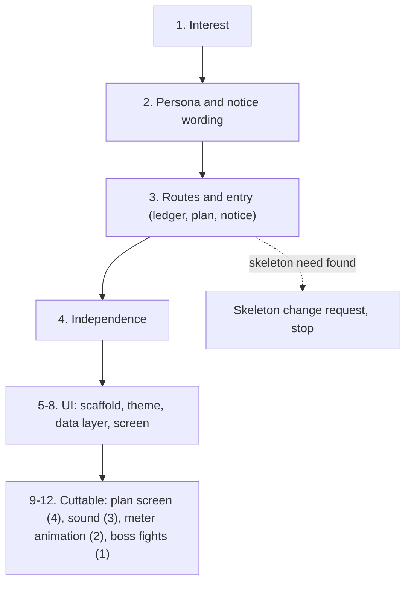

# Implementation Plan: debt-collector
Status: **draft for review.** Nothing here has been started.
## How to run this plan
- **One task at a time, via the "Start task" control, in a fresh session** (`credit-policy.md` rules 2, 3, 5). Read the diff, run the task's check, commit, then start the next. Never "run all tasks".
- **Regenerate at most once.** If the second attempt is wrong, fix the requirement or design by hand and re-run (rule 4).
- **Size rule (R9.1):** twelve tasks, each touching **one subsystem and at most three files**. The count includes source, tests, fixtures and hand-edited config. Lockfiles are not counted. `debt-collector/` has no `__init__.py`. Paths starting with `src/`, `test/` or `index.html` are relative to `debt-collector/ui/`. Python tests live in `tests/debt_collector/` and import app modules with `importlib.import_module("debt-collector.<module>")`; inside the app, modules use relative imports (design §1).
- **Stop rule (R8):** if a task seems to need an edit under `skeleton/`, stop, make no edit there, and record a skeleton change request in `docs/KIRO-USAGE.md`. Do not monkeypatch, fork or call skeleton internals to get around it. Do not import `medium`.
- **Cut order (R9.3):** tasks marked `CUTTABLE n` are cut in that order, 1 first, and never out of it. Everything unmarked is not cuttable. The cuttable tasks are built in reverse (4, 3, 2, 1), so the last thing cut is the first thing built.
- **No key needed:** no task calls a real model. The notice route is tested with `FakeLLMClient`. Everything else runs with no provider and no network.
- **Model routing (`credit-policy.md`):** Auto by default, Haiku where noted, no Opus. After each group, log actual credits in `docs/CREDIT-BUDGET.md`.
- **Checks per task:** `scripts/run-tests.sh tests/debt_collector` and `tests/independence` for Python, `pnpm test` in `debt-collector/ui` for the UI, plus `uv run ruff check .` and `uv run lint-imports`.
## Overview
Twelve tasks in four groups. The arithmetic comes first because everything else shows its numbers. The routes follow, with the ledger and plan before the notice, so the demo's insurance exists before the model does. Independence is proven before any UI exists, so the UI is built under the guard. The UI follows, then the four cuttable pieces.

The limit of twelve forced one compromise (design D10). The three routes and the process entry share task 3, and the persona and the notice wording share task 2. Both stay inside three files each. Task 3 is the largest task here, and the order inside it is fixed: ledger, then plan, then entry, then notice.
## Tasks
- [x] 1. Interest and the figures registry (not cuttable)
  - Subsystem: collector-core. Files (3): `debt-collector/interest.py`, `tests/debt_collector/test_interest.py`, `docs/KIRO-USAGE.md`.
  - `interest.py` per design §2: the frozen models (`LedgerLine`, `Coverage`, `Totals`, `Ledger`, `PlanSource`, `PlanEntry`, `PlanResult`), `price`, `build_ledger`, `build_plan`, `escalation_level`, `LEVELS`, `ESCALATION_CUTOFFS`, `BOSS_COUNT`, `METRIC_UNITS` and `FIGURES`. Constants carry their reasoning in comments. No clock, no random source, no I/O, no `skeleton` import except `skeleton.signals.models.Finding`. Relative imports only inside the folder.
  - `docs/KIRO-USAGE.md`: add SCR-6 and SCR-7 rows to the "Skeleton change requests" table, worded as in R8.3, with evidence "none yet" and blocked task "none (workaround in place)".
  - Tests: formula on hand-computed cases (a one-line range, a long range, severity 0 and 1); rounding to 6 places; Hypothesis CP1 (finite, not negative), CP2 (monotone in severity), CP3 (identical on two runs, shuffle-invariant ranking); ranking tie-breaks; `boss` flags the top `BOSS_COUNT` with interest above zero and none when all interest is zero; CP4 escalation (monotone, each cut-off lands on its level); CP6 plan order and same entries as the ledger; every metric key in `skeleton/signals/*.py` `metrics=` literals (read with `ast`) is in `METRIC_UNITS`, and an unknown key reports `unspecified`; CP5 payload walk over a built ledger and plan; an empty input gives an empty ledger, zero totals and `courtesy`.
  - Done when: `uv run pytest tests/debt_collector/test_interest.py` is green and `uv run ruff check debt-collector tests/debt_collector` is clean.
  - Model: Auto.
  - _Requirements: 1.1 to 1.10, 5.2, 5.3, 8.3_
- [x] 2. Persona and notice wording (not cuttable)
  - Subsystem: collector-voice. Files (3): `debt-collector/personas/collector.toml`, `debt-collector/notice.py`, `tests/debt_collector/test_voice.py`.
  - The collector per design §3. Read `TOOL_NAMES` from `skeleton.mcp.contract` and choose `allowed_tools` from it. Wording must: tell the collector never to state a principal, an interest or a total (they are in the ledger); put every figure only in the `figures` list; say "I suspect" only when no tool result supports a statement; describe the register of `courtesy`, `reminder`, `demand` and `final` in words; aim menace at the code and time, never at maintainers. No digit in any text field.
  - `notice.py`: `NOTICE_TEMPLATE` and `notice_question(level)` per design §5.2. It raises `ValueError` for a word not in `LEVELS`.
  - Tests: `load_persona` succeeds and `warnings == []`; no digit in `voice`, `goals`, `example_lines` or `decline_line`; `allowed_tools` is a subset of `TOOL_NAMES` and includes the three required tools; `load_personas` over a directory holding only this file returns exactly `collector`; `create_app` starts with it (FakeLLMClient); the voice names every level in `LEVELS`, says "figures" and "I suspect", and tells the collector not to state interest; `notice_question` has no digit for every level, contains the level word, and rejects an unknown word; `decline_line` contains no digit and makes no claim about code (read by eye, asserted only for digits).
  - Done when: `uv run pytest tests/debt_collector/test_voice.py` is green.
  - Model: Auto.
  - _Requirements: 2.1 to 2.8, 4.3_
- [x] 3. Ledger, plan and notice routes, and the process entry (not cuttable)
  - Subsystem: collector-api. Files (3): `debt-collector/api.py`, `debt-collector/main.py`, `tests/debt_collector/test_routes.py`.
  - `api.py`: `create_collector_app(store, llm, cfg=None)` and a router, per design §4 and §5.1. One helper opens `httpx.AsyncClient(transport=ASGITransport(app=request.app))`. `_read_findings` follows §4.1: detail, then unfiltered `limit=100`, then per-analyzer calls only when the first response was clamped. Order inside the task: ledger route, plan route, then notice route. A non-200 from the skeleton is returned with its status and body, and nothing partial. The notice returns the `/ask` bytes unchanged. `api.py` constructs no `AnswerResult`, `VerifiedClaim` or `Citation`.
  - `main.py`: `build_app(env, client_factory)` and `main()` per design §6, with `OfflineClient` and the `COLLECTOR_*` to `providers.select` translation. The only provider import is `providers.select`.
  - Tests, in this order: **(no model)** ledger on a store with several analyzers and more than 100 findings for one (ranked, ids match the skeleton's `id`, `coverage` and `truncated` correct, boss flags, units); empty snapshot gives an empty ledger; `snapshot_not_found` returned unchanged with no partial ledger; ledger and plan with a client that raises on any call (CP8, zero calls); plan equals the ledger's findings, ordered by `interest_per_effort` (CP6); every plan `source` resolves through `GET /snapshots/{ref}/files/{path}?line_start=&line_end=` with 200 (CP7); `build_app` with an empty environment gives 200 for ledger and plan. **(FakeLLMClient)** notice response equals the skeleton's own `/ask` for the same script (CP9); the recorded request question has no digit and names the level the ledger reports (CP11); a claim repeating a computed interest is banished as `unbacked_number` (CP10); with no provider the notice is `declined` with the collector's decline line; `snapshot_not_found` on the notice is returned unchanged; a grep of `api.py` finds none of `AnswerResult(`, `VerifiedClaim(`, `Citation(`, `LLMRequest`, `assemble_system_prompt`; a grep of `debt-collector/` finds no `import medium`.
  - After the task passes, run the ledger once against `demo/patient.json`'s snapshot if one exists locally, and check the four cut-offs by eye (design §2.5). If they need to move, that is a one-line edit to `ESCALATION_CUTOFFS` in `interest.py` and its test, and it is the only edit allowed after the task's checks pass.
  - Done when: `uv run pytest tests/debt_collector` is green.
  - Model: Auto.
  - _Requirements: 3.1 to 3.7, 4.1, 4.2, 4.4 to 4.8, 5.1, 5.2, 5.4, 5.5_
- [x] 4. Independence tests and import contracts (not cuttable)
  - Subsystem: independence. Files (3): `.importlinter`, `tests/independence/test_contracts.py`, `tests/independence/test_debt_collector.py`.
  - Run the existing contracts first and note they pass. Then edit `.importlinter` per design §8: add `debt-collector` and `medium` to `root_packages`; add the three contracts (no `medium`, no model SDK, only the skeleton's public surface). Confirm the existing four give the same result. If `medium` as a root package changes an existing result, stop and record why.
  - `test_contracts.py`: a planted-violation test for each new contract (`debt-collector/_planted_<name>.py`, deleted in `finally`), asserting `lint-imports` fails and names the contract.
  - `test_debt_collector.py`: CP12, a SHA-256 manifest of `skeleton/` identical before and after one ledger, one notice and one plan through `create_collector_app` with `FakeLLMClient`; `skeleton/` holds none of `debt-collector`, `debt_collector`, the persona's quoted name, display name, example lines or decline line, with `skeleton/ingest/history.py` and the existing guard files checked and allow-listed with a reason; `debt-collector/` is at the repository root with no `__init__.py`; no file under `debt-collector/` imports `anthropic`, `openai`, `boto3`, `google` or `medium` (an `ast` scan, so the check holds without the linter).
  - Done when: `uv run pytest tests/independence` and `uv run lint-imports` are green, with seven contracts kept.
  - Model: Auto.
  - _Requirements: 7.1 to 7.7_
- [x] 5. UI scaffold (not cuttable)
  - Subsystem: collector-ui. Files (3): `debt-collector/ui/package.json`, `debt-collector/ui/vite.config.ts`, `debt-collector/ui/tsconfig.json`.
  - React 18, Vite, TypeScript, `@kiroween/ui-shell` as `link:../../skeleton/ui-shell`, vitest, jsdom, testing-library, `vitest-axe`. Mirror the shell's versions and scripts (`test`, `build`, `lint`). Dev proxy for `/snapshots` and `/collector` to the API. The `@vitejs/plugin-react` plugin and the jsdom test environment are set in `vite.config.ts`.
  - Done when: `pnpm install && pnpm build` is green on a stub entry that imports one shell export.
  - Model: Haiku.
  - _Requirements: 6.1_
- [x] 6. Ledger theme and its tests (not cuttable)
  - Subsystem: collector-ui. Files (3): `src/theme/ledger.ts`, `test/theme.test.ts`, `test/lint.test.ts`.
  - `ledger.ts`: a `Theme` data object, `id = "ledger"`, from the shell's reference palette, with its own `effects` (visible bezel, faint scanlines, flicker 0) and `sounds: {}`. Data only, no component.
  - `theme.test.ts`: every pair in `REQUIRED_PAIRS` meets `MIN_CONTRAST_RATIO`; effects in 0..1. This test is not cuttable.
  - `lint.test.ts`: a grep fails if any file under `skeleton/ui-shell/src/` or `debt-collector/ui/src/` contains `theme.id` or a comparison with a theme name; a grep fails if a file under `debt-collector/ui/src/` declares `CrtFrame`, `ChatPanel` or `Meter`, or imports from `medium`.
  - Done when: `pnpm test theme lint` is green.
  - Model: Auto.
  - _Requirements: 6.2, 6.3, 6.4_
- [x] 7. UI data layer (not cuttable)
  - Subsystem: collector-ui. Files (3): `src/api.ts`, `src/state.ts`, `test/data.test.ts`.
  - `api.ts`: wrappers for `GET /snapshots/{ref}`, `GET /collector/snapshots/{ref}/ledger`, `POST …/notice` and `GET …/plan`. Types for the ledger and plan mirror `interest.py`'s models by hand (the shell's `AnswerResult` is re-exported, not redefined). A structured error becomes an `ApiError` with code and message.
  - `state.ts`: pure `outstanding`, `meterValue`, `settle`, and number formatting that never rounds beyond the payload's six places. The reducer holds `settled` as a set of finding IDs, the pending flag, and the notice result as the unmodified object.
  - Tests: mocked fetch and the request bodies; a structured error becomes an `ApiError`; CP13 as a property (meter value in [0, 1], falls as debts are settled, 0 when the total is 0); settling sends no request; a second submit while pending is ignored; the stored notice is referentially equal to the input.
  - Done when: `pnpm test data` is green.
  - Model: Auto.
  - _Requirements: 6.5, 6.6, 6.7, 6.8_
- [x] 8. The screen (not cuttable)
  - Subsystem: collector-ui. Files (3): `index.html`, `src/App.tsx`, `test/App.test.tsx`.
  - `index.html` mounts `App` from an inline module script. `App.tsx`: `ThemeProvider(ledger)` > `SoundProvider` > `CrtFrame` containing `Meter` (the debt meter), the ledger list (own markup: rank, `file:lines`, severity, principal, interest, `finding_id`, units, a "Mark settled" control, `data-boss` on boss rows, the escalation level and the coverage note), a "Serve notice" control, and `ChatPanel` for the notice (`result` unmodified, `licence` from the snapshot). Pending state, an `aria-live` error region, labelled keyboard-operable controls. No theme branching.
  - Tests: a fixture ledger renders every line with its numbers and units; settling lowers the meter and sends no request; the notice fixture with a verified claim, a guess, a banishment and a decline renders through `ChatPanel` with the banishment visibly struck; a failed notice shows its error code and leaves the ledger on screen; with the notice route rejecting, the ledger and meter still render (model down); `truncated` shows the coverage note; axe reports no violation.
  - Done when: `pnpm test App && pnpm build` is green.
  - Model: Auto.
  - _Requirements: 6.4 to 6.10_
- [x] 9. Repayment-plan screen (CUTTABLE 4, built first of the cuttable tasks)
  - Subsystem: collector-ui. Files (3): `src/PlanPanel.tsx`, `src/App.tsx`, `test/PlanPanel.test.tsx`.
  - A "Show repayment plan" control calls the plan route and renders the entries in the order received: rank, `file:line_start-line_end`, effort, interest, interest per effort, and the finding ID it came from. A plan error shows the structured error and no partial plan. The panel reorders nothing.
  - Cut: the plan route and its tests stay. The plan is not shown in the UI.
  - Done when: `pnpm test PlanPanel` is green.
  - Model: Auto.
  - _Requirements: 5.2, 5.3, 6.8_
- [x] 10. Sound cues (CUTTABLE 3)
  - Subsystem: collector-ui. Files (3): `src/theme/ledger.ts`, `src/App.tsx`, `test/sound.test.tsx`.
  - Read the shell's `SoundSpec` and `useSound` (`skeleton/ui-shell/src/sound/`). Add specs for `settle`, `notice` and `banish` to the theme's `sounds`. `App` calls `useSound().play(...)` on settling, on a received notice, and for each banishment in it. The shell emits no sound by itself, so the app names the events.
  - Tests: every event `App` plays has a spec in the theme; a muted provider plays nothing; the contrast and grep tests stay green.
  - Cut: the collector is silent.
  - Done when: `pnpm test sound theme lint` is green.
  - Model: Haiku.
  - _Requirements: 6.2, 6.9_
- [x] 11. Meter animation (CUTTABLE 2)
  - Subsystem: collector-ui. Files (3): `src/useDrain.ts`, `src/App.tsx`, `test/drain.test.tsx`.
  - `useDrain(target)` returns the displayed outstanding-interest readout, counting down to the target in steps over a fixed short time. With `useReducedMotion` true it returns the target at once and starts no timer. The `Meter` bar keeps the shell's own transition. The readout is arithmetic over ledger numbers, not model output.
  - Tests with fake timers: the readout steps down and ends exactly on the target; a new target mid-drain restarts from the current value; reduced motion returns the target with no timer.
  - Cut: the readout jumps. The meter still falls.
  - Done when: `pnpm test drain` is green.
  - Model: Auto.
  - _Requirements: 6.6, 6.9_
- [ ] 12. Boss fights (CUTTABLE 1)
  - Subsystem: collector-ui. Files (3): `src/boss.css`, `src/App.tsx`, `test/boss.test.tsx`.
  - Visual treatment for rows with `data-boss="true"`: a heavy rule, a "largest debt" label, colours from the theme's CSS variables (`themeToCssVars`), any pulse disabled under reduced motion by media query. `App` imports the stylesheet. No `theme.id` branch.
  - Tests: boss rows carry the label and the others do not; the label text is in the accessibility tree; with the stylesheet removed the rows still render (the hook is `data-boss`, not the styling); axe reports no violation.
  - Cut: boss rows look like the others. The `boss` flag stays in the payload.
  - Done when: `pnpm test boss` is green.
  - Model: Auto.
  - _Requirements: 1.8, 6.3, 6.9_
## Requirement coverage
| Requirement | Tasks |
|---|---|
| R1 Interest | 1, 12 (boss visual) |
| R2 Persona | 2 |
| R3 Ledger route | 3 |
| R4 Notice route | 2, 3 |
| R5 Repayment plan | 1, 3, 9 |
| R6 UI | 5, 6, 7, 8, 9, 10, 11, 12 |
| R7 Independence | 4 |
| R8 Stop conditions | 1 (records SCR-6 and SCR-7), every task |
| R9 Delivery constraints | this file |
