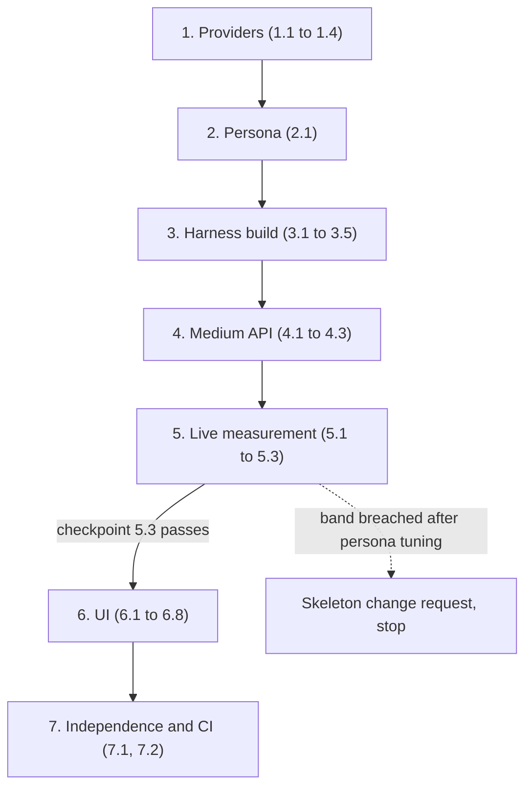

# Implementation Plan: medium
Status: **draft for review.** Nothing here has been started.

## How to run this plan
- **One task at a time, via the "Start task" control, in a fresh session** (`credit-policy.md` rules 2, 3, 5). Read the diff, run the task's check, commit, then start the next. Never "run all tasks".
- **Regenerate at most once.** If the second attempt is wrong, fix the requirement or design by hand and re-run (rule 4).
- **Size rule (R10.1):** every task touches **one subsystem and at most three files**. The count includes source, tests, fixtures and hand-edited config. Lockfiles are not counted. Packages are namespace packages, so there are no empty `__init__.py` files. Paths in group 6 starting with `src/` or `test/` are relative to `medium/ui/`.
- **Stop rule (R9):** if a task seems to need an edit under `skeleton/`, stop, make no edit there, and record a skeleton change request in `docs/KIRO-USAGE.md`. Do not monkeypatch, fork or call skeleton internals to get around it.
- **Ordering (R10.3):** providers, persona and the whole harness, including the live runs and tuning, come before any UI task. Group 6 does not start until checkpoint 5.3 passes.
- **Cut order (R10.5):** tasks marked `CUTTABLE n` are cut in that order and never out of it. Everything unmarked is not cuttable.
- **Tests per hook:** keep Python tests under `tests/providers/`, `tests/medium/` and `tests/independence/`. UI tests live in `medium/ui/test/`.
- **Provider spend:** tasks 5.1 and 5.2 call the real model and spend the provider budget, not Kiro credits. They need `ANTHROPIC_API_KEY` in the environment and network access.
- **Model routing (`credit-policy.md`):** Auto by default, Haiku where noted. No Opus prompt is planned.

## Overview
Seven groups, 26 tasks. Providers come first because the harness needs a real client. The persona and the harness follow, then the live measurement, which is the point of the spec and a gate for everything after it. The UI is built only once the rate is known to be in band, or a skeleton change request is filed. Independence and CI close the plan.

## Tasks
- [x] 1. Providers (not cuttable)
  - [x] 1.1 Request and response mapping
    - Subsystem: providers. Files (3): `providers/mapping.py`, `tests/providers/test_mapping.py`, `pyproject.toml`.
    - `pyproject.toml`: add runtime dependency `anthropic`. `mapping.py`: pure functions per design §2.2, with no SDK import (it builds plain dicts and reads response objects by attribute): `to_sdk_kwargs(request) -> dict`, `from_sdk_response(response) -> LLMResponse`. Merge consecutive tool messages into one user message of `tool_result` blocks. Omit `tools` when empty. Raise `ProviderError` on `stop_reason == "max_tokens"`.
    - Tests: each row of the §2.2 table; consecutive tool messages merge; empty tools omits the key; empty response gives an empty `LLMResponse`; Hypothesis MP2 (every call id round-trips).
    - Done when: `uv run pytest tests/providers/test_mapping.py` is green.
    - Model: Auto.
    - _Requirements: 1.3, 1.4, 1.5, 1.8_
  - [x] 1.2 AnthropicClient and ProviderError
    - Subsystem: providers. Files (3): `providers/errors.py`, `providers/anthropic_client.py`, `tests/providers/test_anthropic_client.py`.
    - `ProviderError`. `AnthropicClient` per design §2.1: default SDK is `AsyncAnthropic(api_key, timeout=timeout_s, max_retries=0)`; `from_env` is the only env read; injected `sdk` for tests. `complete` makes exactly one `messages.create` call and wraps SDK errors as `ProviderError(f"{type(exc).__name__} status={status}")`, never `str(exc)`. `CancelledError` is not caught.
    - Tests: MP1 (one SDK call per `complete`; constructor kwargs include `max_retries=0` and a timeout); MP3 (a fake SDK error embedding the key, the system prompt and the response text yields a `ProviderError` containing none of them); timeout becomes `ProviderError`; `from_env` with no variable raises a message naming the variable and containing no value; satisfies `LLMClient` structurally (`isinstance`-free check by calling it through `ToolLoopGenerator` with a fake SDK, one tool round).
    - Done when: `uv run pytest tests/providers` is green.
    - Model: Auto.
    - _Requirements: 1.2, 1.6, 1.7, 1.8, 1.9, 1.10, 1.11_
  - [x] 1.3 Live provider test
    - Subsystem: providers. Files (2): `tests/providers/test_live.py`, `pyproject.toml`.
    - Add the `live` marker to `pyproject.toml` (excluded by default alongside `network`). One real call with a one-tool request; assert a well-formed `LLMResponse` (text or one `ToolCall` whose name is in the request's tools). Skips with a clear reason when `ANTHROPIC_API_KEY` is unset.
    - Done when: `uv run pytest -m live tests/providers` is green with a key set, and the default run still skips it.
    - Model: Haiku.
    - _Requirements: 1.14_
  - [x] 1.4 Fourth import-linter contract
    - Subsystem: independence. Files (2): `.importlinter`, `tests/independence/test_contracts.py`.
    - Run the existing contracts first and note they pass. Change `root_package = skeleton` to `root_packages = skeleton, providers`. Add the contract `skeleton must not import providers` (design §2.3). Add a planted-violation test (`skeleton/verify/_planted_providers.py`, deleted in `finally`) asserting the lint fails. Confirm the three existing contracts still pass unchanged.
    - Done when: `uv run pytest tests/independence/test_contracts.py` and `uv run lint-imports` are green.
    - Model: Auto.
    - _Requirements: 1.1, 1.12, 1.13_
- [x] 2. Persona (not cuttable)
  - [x] 2.1 The ghost persona
    - Subsystem: personas-config. Files (2): `medium/personas/ghost.toml`, `tests/medium/test_persona.py`.
    - Write the ghost per design §3. Read `TOOL_NAMES` from `skeleton.mcp.contract` and choose `allowed_tools` from it. Persona wording must tie guesses to "no tool result supports this", and say figures go only in the `figures` list (design §12.2). No digit in any text field. Humour targets the code and time, never the maintainers.
    - Tests: `load_persona` succeeds; `warnings == []`; no digit in `voice`, `goals`, `example_lines`, `decline_line`; `allowed_tools` is a subset of `TOOL_NAMES`; `load_personas` over a directory holding only this file returns exactly one persona named `ghost`; `create_app` starts with it (FakeLLMClient).
    - Done when: `uv run pytest tests/medium/test_persona.py` is green.
    - Model: Auto.
    - _Requirements: 2.1 to 2.8_
- [x] 3. Harness build (not cuttable)
  - [x] 3.1 Plan section questions and models
    - Subsystem: medium-api. Files (2): `medium/plan.py`, `tests/medium/test_plan_prompts.py`.
    - `SECTIONS`, `SECTION_QUESTIONS` (no digit, independent, asking for modernisation steps tied to cited code, tone per R2.7), `PlanSection`, `PlanResult` (design §4). Imports `AnswerResult` from `skeleton.verify.models` only.
    - Tests: three sections in fixed order; no digit in any question; no question mentions another section's output; models round-trip an `AnswerResult` unchanged.
    - Done when: `uv run pytest tests/medium/test_plan_prompts.py` is green.
    - Model: Auto.
    - _Requirements: 6.1, 6.4, 6.8_
  - [x] 3.2 The fixed question set
    - Subsystem: eval. Files (2): `medium/eval/questions.toml`, `tests/medium/test_questions.py`.
    - 20 questions with `id` and `category`. Categories and minimums per R3.2: 4 churn or staleness, 3 TODO, 3 one named file (pick real files from the patient's findings and record the SHA in a comment), 4 exact-number, 3 unanswerable, and 3 plan sections referenced as `plan:requirements`, `plan:design`, `plan:tasks`. The remaining questions are general.
    - Tests: exactly 20; unique ids; category minimums; plan ids resolve against `SECTION_QUESTIONS`; no question asks about people or blames maintainers (keyword check on a short list).
    - Done when: `uv run pytest tests/medium/test_questions.py` is green.
    - Model: Auto.
    - _Requirements: 3.1, 3.2, 3.3_
  - [x] 3.3 Metrics and bands
    - Subsystem: eval. Files (2): `medium/eval/metrics.py`, `tests/medium/test_metrics.py`.
    - Pure functions per design §5.2 and the band constants of §5.3, each with its reasoning in a comment. `compute(results) -> Report` (overall and per category), `breaches(report) -> list[Breach]`, `render(report) -> str` (counts beside shares). Zero denominators yield `None`, rendered `n/a`.
    - Tests: hand-built `AnswerResult`s for all-fact, all-guess, declined, answered-after-regeneration and mixed turns, with the exact expected shares; MP6 (Hypothesis partition); MP7; a breach is reported for each band when forced; `empty_answers` counted separately.
    - Done when: `uv run pytest tests/medium/test_metrics.py` is green.
    - Model: Auto.
    - _Requirements: 3.6, 3.7, 3.8, 3.9_
  - [x] 3.4 Harness runner
    - Subsystem: eval. Files (2): `medium/eval/__main__.py`, `tests/medium/test_eval_runner.py`.
    - CLI per design §5.1: `--runs`, `--max-turns`, `--questions`. Builds `create_medium_app`-equivalent via `create_app` plus the ghost persona with `ApiConfig(allow_retained=True)` in a `TestClient`; ingests the patient as retained from `demo/patient.json`; asks every question through `POST /snapshots/{ref}/ask`; writes `medium/eval/runs/<UTC>-<n>.json`; prints the report; exits non-zero on a breach or abort; aborts after 3 consecutive `ProviderError` turns. Accepts an injected client and an injected ingest function for tests.
    - Tests (FakeLLMClient, injected ingest over the skeleton's fixture repo): the harness asks through `/ask` (a spy on the route sees every question); a scripted all-guess run exits non-zero and names the breached bands; three consecutive provider errors abort; the run file is written and parses back to the same report; a grep asserts the module imports none of `run_grounded_turn`, `verify_claim`, `ToolLoopGenerator`.
    - Done when: `uv run pytest tests/medium/test_eval_runner.py` is green.
    - Model: Auto.
    - _Requirements: 3.4, 3.5, 3.9, 3.10, 3.12, 3.13_
  - [x] 3.5 Record the bands and seed the skeleton change requests
    - Subsystem: docs. Files (2): `docs/KIRO-USAGE.md`, `docs/CREDIT-BUDGET.md`.
    - In `docs/KIRO-USAGE.md` add the sections "Banishment rate (Medium)" with the bands and their reasons copied from `metrics.py`, and "Skeleton change requests" seeded with SCR-1 to SCR-4 from design §7. In `docs/CREDIT-BUDGET.md` log the spec-phase actuals read from the dashboard.
    - Done when: both files contain the sections and the bands match `metrics.py` (read by eye; no test).
    - Model: Haiku.
    - _Requirements: 3.8, 3.14, 9.1, 9.2, 10.7_
- [x] 4. Medium API (not cuttable)
  - [x] 4.1 Plan route and app factory
    - Subsystem: medium-api. Files (2): `medium/api.py`, `tests/medium/test_plan_route.py`.
    - `create_medium_app(store, llm, cfg=None)`: calls `skeleton.api.app.create_app(..., persona_dir=<medium/personas>)` and includes a router with `POST /medium/snapshots/{ref}/plan` per design §4. Sections run sequentially through `httpx.AsyncClient(transport=ASGITransport(app))`. A non-200 section response is returned unchanged and stops the loop.  `httpx` is already a runtime dependency in `pyproject.toml`.
    - Tests: MP4 (each section equals a direct `/ask`); MP5 (a fabricated citation shows as banished or declined, never verified); a declined section leaves the others intact; `snapshot_not_found` is returned unchanged with no partial plan; the route source contains no `AnswerResult(`, `VerifiedClaim(` or `Citation(` construction (grep).
    - Done when: `uv run pytest tests/medium/test_plan_route.py` is green.
    - Model: Auto.
    - _Requirements: 6.1, 6.2, 6.3, 6.5, 6.6, 4.7_
  - [x] 4.2 Process entry point
    - Subsystem: medium-api. Files (2): `medium/main.py`, `tests/medium/test_main.py`.
    - Build `AnthropicClient.from_env(MEDIUM_MODEL)`, store from `CRYPT_STORE`, run uvicorn. Missing key fails at startup naming the variable, printing no value. Pin the default model id in one constant.
    - Tests: missing key raises at build time with the variable name and no secret; the built app serves `/medium/...` and `/snapshots/...` (with FakeLLMClient injected through a factory seam).
    - Done when: `uv run pytest tests/medium/test_main.py` is green.
    - Model: Haiku.
    - _Requirements: 1.10, 1.12_
  - [x] 4.3 Interview loop end to end (server side)
    - Subsystem: medium-api. Files (1): `tests/medium/test_interview_e2e.py`.
    - Through `create_medium_app` with `FakeLLMClient`: a verified answer, a banished-then-regenerated answer, and a decline each return `AnswerResult` JSON whose fields equal the skeleton app's own response for the same script; the decline carries the ghost's `decline_line`.
    - Done when: `uv run pytest tests/medium/test_interview_e2e.py` is green.
    - Model: Auto.
    - _Requirements: 4.1, 4.2, 4.7_
- [x] 5. Live measurement (not cuttable; this is the gate for group 6)
  - [x] 5.1 First live runs
    - Subsystem: eval. Files (3): `docs/KIRO-USAGE.md` and two raw run files under `medium/eval/runs/`.
    - Needs `ANTHROPIC_API_KEY` and network. Run `uv run python -m medium.eval --runs 2`. Record **both** reports in `docs/KIRO-USAGE.md` with the run file paths, model id, patient SHA, date, per-category shares and counts, breached bands, and the provider-dashboard spend. Do not average the runs. Read five raw turns and check the persona's tone against `demo-patient.md` obligations.
    - Done when: both runs are recorded. A breach is a finding, not a failure of this task.
    - Model: Auto.
    - _Requirements: 3.11, 3.14, 3.16_
  - [x] 5.2 Tune persona wording (conditional; skip if both runs are in band)
    - Subsystem: personas-config. Files (3): `medium/personas/ghost.toml`, `docs/KIRO-USAGE.md`, one new run file under `medium/eval/runs/`.
    - Use only R3.15's in-app lever: the persona wording, guided by design §5.4. Change one thing per iteration, record why, and re-run once. **At most two iterations.** Keep the digit-free test green. Do not touch `skeleton/` and do not change the question set or the bands. If a band is still breached after iteration two, write the skeleton change request (R9.2) for the lever the symptom points to (SCR-2, SCR-3 or SCR-4), attach the run files, and stop.
    - Done when: the latest run is in band, or a skeleton change request is recorded and the user has decided how to proceed.
    - Model: Auto.
    - _Requirements: 3.15, 9.1, 9.2, 9.4_
  - [x] 5.3 Checkpoint: rate gate
    - Subsystem: eval. Files (0). No code.
    - Confirm that `docs/KIRO-USAGE.md` holds at least two runs, that the latest is in band or a change request is filed with the user's decision on it, and that `git status` shows no change under `skeleton/`. Group 6 starts only after this passes.
    - Done when: `git diff --stat -- skeleton/` is empty and the record above exists.
    - Model: Auto.
    - _Requirements: 3.16, 10.3, 9.1_
- [x] 6. UI (starts only after 5.3)
  > **Gate 5.3 closed 2026-11-28.** Two runs recorded in `docs/KIRO-USAGE.md`: 9 turns,
  > 46 judged claims, 87.0% verified, 13.0% guesses, **0 declined and 0 banished**, on two
  > different providers. Four of five bands pass comfortably. The fifth, turns-with-a-
  > banishment, is breached at its floor because nothing was ever fabricated and so nothing
  > needed rejecting.
  >
  > 5.2's exit condition was "the latest run is in band **or** a change request is recorded
  > and the user has decided how to proceed". No persona tuning was done: inducing
  > banishments would mean degrading the ghost on purpose to satisfy a metric. The breach is
  > accepted and recorded, with the consequence that the demo must show a banishment
  > deliberately rather than wait for one. Group 6 is unblocked.

  - [x] 6.1 Package scaffold
    - Subsystem: medium-ui. Files (3): `medium/ui/package.json`, `medium/ui/vite.config.ts`, `medium/ui/tsconfig.json`.
    - React 18, Vite, TypeScript, `@kiroween/ui-shell` as `link:../../skeleton/ui-shell`, vitest, jsdom, testing-library, `vitest-axe`. Dev proxy for `/snapshots` and `/medium` to the API. Mirror the shell's versions.
    - Done when: `pnpm install && pnpm build` is green on an empty entry.
    - Model: Haiku.
    - _Requirements: 7.4_
  - [x] 6.2 The seance theme
    - Subsystem: medium-ui. Files (2): `src/theme/seance.ts`, `test/theme.test.ts`.
    - `Theme` data object `id = "seance"`: amber or phosphor-on-black palette distinct from the shell's `phosphor` and `ledger`, font, effects, no sounds yet. Tests: every `REQUIRED_PAIRS` pair meets `MIN_CONTRAST_RATIO`; effects in 0..1; a grep fails if any file under `skeleton/ui-shell/src/` or `medium/ui/src/` contains `theme.id` or a theme-name comparison.
    - Done when: `pnpm test theme` is green.
    - Model: Auto.
    - _Requirements: 7.1, 7.2, 7.3, 7.5_
  - [x] 6.3 API client and types
    - Subsystem: medium-ui. Files (3): `src/api.ts`, `src/types.ts`, `test/api.test.ts`.
    - Wrappers for `GET /snapshots/{ref}`, `GET /snapshots/{ref}/findings`, `POST /snapshots/{ref}/ask` (persona fixed to `ghost`) and `POST /medium/snapshots/{ref}/plan`. `types.ts` re-exports `AnswerResult` from the shell and defines `PlanResult` and `ApiError`. Structured errors are surfaced as `ApiError` with `code` and `message`, never flattened.
    - Tests: mocked fetch; the request bodies; a structured error becomes an `ApiError`.
    - Done when: `pnpm test api` is green.
    - Model: Auto.
    - _Requirements: 4.1, 4.5_
  - [x] 6.4 Interview state and possession derivation
    - Subsystem: medium-ui. Files (2): `src/state.ts`, `test/state.test.ts`.
    - Pure reducer and selectors per design §6: `cited(result)` (verified claims only, first-appearance order), `files` (findings files union cited, sorted), `active` (first cited or user selection), pending flag blocking a second submission. Turns store the unmodified `AnswerResult`.
    - Tests: MP8 (property: banished citations never appear in `cited`); union guarantees every cited file is in `files`; selecting a file sets `active` and issues no request action; a second submit while pending is ignored; stored result is referentially equal to the input.
    - Done when: `pnpm test state` is green.
    - Model: Auto.
    - _Requirements: 4.2, 4.4, 5.1, 5.2, 5.3, 5.5_
  - [x] 6.5 Interview screen
    - Subsystem: medium-ui. Files (3): `src/App.tsx`, `src/main.tsx`, `test/App.test.tsx`.
    - `ThemeProvider(seance)` > `SoundProvider` > `CrtFrame` containing `FileTree` (`files`, `cited`, `active`, `onSelect`), one `ChatPanel` per turn (`result` unmodified, `licence` from the snapshot), a labelled question field submitting on Enter, a pending state and an `aria-live` error region. The snapshot `ref` comes from the URL query. No shell component is forked.
    - Tests: a fixture `AnswerResult` with a verified claim, a guess, a banishment and a decline renders through the shell with the banishment visibly struck; the cited file's ancestors are expanded; the licence is shown; Enter submits; a structured API error shows its code; axe reports no violations.
    - Done when: `pnpm test App && pnpm build` is green.
    - Model: Auto.
    - _Requirements: 4.1 to 4.6, 5.2, 7.4_
  - [x] 6.6 Possession sweep (CUTTABLE 2)
    - Subsystem: medium-ui. Files (3): `src/useSweep.ts`, `src/App.tsx`, `test/sweep.test.tsx`.
    - Hook stepping `active` through `cited` in claim order on a timer. With `useReducedMotion` true it sets `active` to the first cited file and starts no timer. App uses it.
    - Cut: `active` stays the first cited file. The tree still shows every cited file.
    - Done when: `pnpm test sweep` is green (fake timers; reduced-motion case).
    - Model: Auto.
    - _Requirements: 5.4, 7.5_
  - [x] 6.7 Plan panel (CUTTABLE 3)
    - Subsystem: medium-ui. Files (3): `src/PlanPanel.tsx`, `src/App.tsx`, `test/PlanPanel.test.tsx`.
    - A "Resurrect" control calls the plan route and renders the three sections, each with `ChatPanel` and its section heading. A declined section shows its decline; a plan error shows the structured error and no partial plan.
    - Cut: the route stays and is measured; the plan is not shown in the UI.
    - Done when: `pnpm test PlanPanel` is green.
    - Model: Auto.
    - _Requirements: 6.5, 6.6, 6.7_
  - [x] 6.8 Theme sound cues (CUTTABLE 1)
    - Subsystem: medium-ui. Files (2): `src/theme/seance.ts`, `test/theme.test.ts`.
    - Add `sounds` entries for the event names the shell emits (read them from `skeleton/ui-shell/src/sound/`). Tests: every event the shell emits has a spec; contrast and grep tests stay green.
    - Cut: the Medium is silent.
    - Done when: `pnpm test theme` is green.
    - Model: Haiku.
    - _Requirements: 7.6_
- [ ] 7. Independence and CI (not cuttable)
  - [x] 7.1 Medium independence tests
    - Subsystem: independence. Files (1): `tests/independence/test_medium.py`.
    - MP9 (skeleton manifest unchanged by a full turn and a full plan through `create_medium_app` with `FakeLLMClient`); `skeleton/` contains none of `medium`, `ghost`, `providers`, `anthropic` outside the documented allow-list; `medium/` imports no `anthropic`, `openai`, `boto3` or `debt_collector`; `medium/` imports nothing from `skeleton.verify` except `skeleton.verify.models`, and nothing from `skeleton.personas.generator`, `.prompt` or `skeleton.mcp.router`; `medium/` and `providers/` exist at the repo root.
    - Done when: `uv run pytest tests/independence` is green.
    - Model: Auto.
    - _Requirements: 8.1 to 8.5, 9.4_
  - [ ] 7.2 CI jobs
    - Subsystem: integration. Files (1): `.github/workflows/ci.yml`.
    - Add the Medium Python tests (default run, `live` and `network` excluded), the fourth contract through the existing `lint-imports` job, and `pnpm test` plus `pnpm build` for `medium/ui`. No job may call the provider. `verify-coverage` stays its own job with nothing depending on it.
    - Done when: a push runs every job and they pass.
    - Model: Haiku.
    - _Requirements: 1.13, 8_

## Notes
- Counts: 7 groups and 26 tasks. Three tasks carry a `CUTTABLE` marker, one per position in R10.5: cut 1 is 6.8, cut 2 is 6.6, cut 3 is 6.7.
- Each cut is a clean deletion. Cutting 6.6 or 6.8 removes a hook or a data entry. Cutting 6.7 removes one component and one import, and leaves the plan route, its tests and its measurement in place.
- Tasks 6.6 and 6.7 both edit `src/App.tsx`. Each counts it as one of its three files, and each edit is a small wiring change, so cutting either leaves a working App.
- Tasks 5.1 and 5.2 are the only ones that spend the provider budget. 5.2 is conditional and capped at two iterations.
- Known open choices, not blockers: the default model id (task 4.2 pins one constant), and the exact tool names for `allowed_tools` (task 2.1 reads them from `TOOL_NAMES`).
