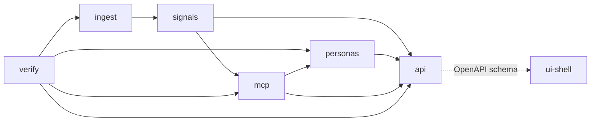
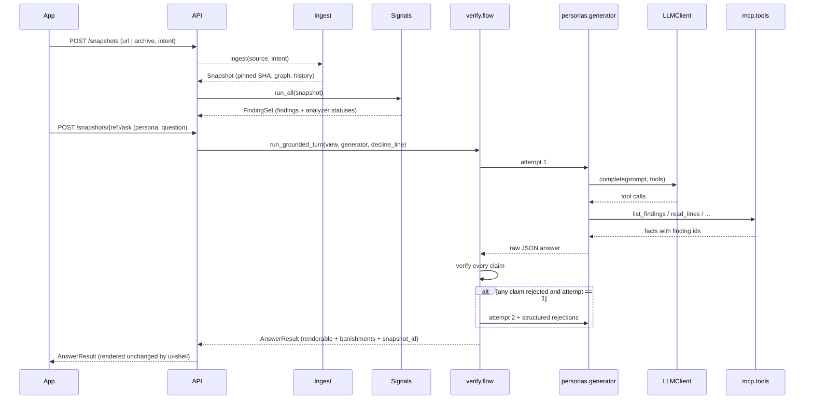

# Design: skeleton

Status: **draft for review.** Tasks are not started. Requirement IDs (R1.8, R4.2, …) refer to `requirements.md`.

## Overview

`skeleton/` is a Python 3.12 package plus one TypeScript package. It ingests a repo into an immutable **snapshot**, runs pure-code analyzers over it to produce **findings**, lets a persona (a TOML file) ask a model questions, and **verifies** every claim in the answer against the snapshot before anything is rendered.

Three design rules drive everything else:

1. **One implementation of "is this citation real".** The MCP server, the API and the verifier all validate paths and ranges through the same `verify` functions. Nothing re-implements them (R5.4).
2. **The verifier is a pure function with no dependency on the rest of the skeleton.** It sees the snapshot through a four-method protocol, so it can be tested exhaustively against an in-memory fake and be held to 100% branch coverage (R4.24).
3. **Enforcement lives in code, not in prompts.** The prompt asks the model to behave. The verifier is what makes it true.

### Decisions that refine or depart from the requirements

Read these first. Each is a place where I had to choose, and where you may disagree. Details are in the section named.

| # | Decision | Where | Requirement touched |
|---|---|---|---|
| D1 | `file_not_found` and `symlink` are decided in one resolution step that checks symlink ancestors **first**. Otherwise `linkdir/a.py` would report `file_not_found` and the `symlink` code for parent segments would be unreachable. | §6.2 | R4.2 order |
| D2 | A guess that carries figures is rejected as `malformed`. No new reason code. | §6.3 | R4.9 |
| D3 | `POST /snapshots` returns a **job** to poll, not a Snapshot ID. The ID is known only after the ref is resolved, which can take the whole clone. | §10.2 | R9.2, R9.8 |
| D4 | Ephemeral snapshots are addressed by an opaque random `ref`, not by Snapshot ID. Two users pasting the same repo must not share a snapshot. "Session end" means a TTL (default 1 h) or an explicit `DELETE`. | §10.3 | R1.15, R9.9 |
| D5 | The `quote` exemption in the prose digit scan applies only to digits inside a **delimited span** (`"…"`, `“…”` or backticks) whose content is a substring of a verified quote. Digits outside a delimiter are not exempt. | §6.4 | R4.11a |
| D6 | The allow-list for prose numbers is **empty by default** and configurable. "Python 3.12" typed bare in prose is banished. Digit runs bound into an identifier (`utf8`, `sha256`) are exempt by the tokeniser boundary in §6.4 step 4, not by the allow-list. | §6.4 | R4.11a |
| D7 | When the second attempt still fails, the result is a decline with **no renderable claims**. Claims that passed on attempt 2 are not shown beside a decline. Banishments from both attempts are shown. | §6.5 | R4.13, R4.16 |
| D8 | `churn` and `staleness` are file-level facts, so their range is the **first symbol** in the file (module docstring, else first class or function), falling back to the first up to 3 lines only when the file has no symbols. An empty file yields no finding. | §5.3 | R2.2, R2.3 |
| D9 | History is computed by one `git log --no-renames`. Renames are not followed and merge commits contribute no files. A renamed file's history starts at the rename. This is stated in the metric docs. | §4.4 | R1.23 |
| D10 | `git blame` gives the commit that last changed the line, not the commit that first introduced the TODO text. `age_days` is documented as "days since this line last changed". | §5.5 | R2.19 |
| D11 | The existing `.kiro/settings/mcp.json` lists tools `get_finding` and `repo_summary` that R5.2 does not define, and passes no snapshot path. The design follows R5.2. **`mcp.json` needs a one-line update, which I have not made.** | §8.4 | R5.10 |
| D12 | `tree-sitter-languages` (named in `tech.md`) is unmaintained and breaks with `tree-sitter >= 0.22`. **Resolved in review: use `tree-sitter-python`, the grammar package published by the tree-sitter project, on current `tree-sitter`.** `tech.md` is amended to match. Pinning `tree-sitter==0.21.*` to keep an unmaintained wrapper alive was rejected: it is a Task 1 that probably fails and costs a day. | §4.3 | tech.md |

## Architecture

### 2.1 Package layout and dependency direction

```
skeleton/
  verify/        pure; imports nothing else from skeleton/           (grounding rule in code)
  ingest/        imports verify.textnorm only
  signals/       imports ingest, verify.textnorm
  personas/      imports verify (types), mcp.contract (tool names), llm
  mcp/           imports signals, ingest, verify
  api/           imports everything above; the only composition root
  ui-shell/      TypeScript; imports nothing from Python, shares generated types
```



Arrows read "is imported by". `import-linter` enforces three contracts in CI (R7.1):

1. **Forbidden:** `skeleton` must not import `medium` or `debt_collector`.
2. **Layers:** the order above, so `verify` cannot import from any other subsystem.
3. **Forbidden externals:** no `anthropic`, `openai` or `boto3` import anywhere in `skeleton` (R7.3). No adapter exists in this spec.

For TypeScript, ESLint `no-restricted-imports` blocks `**/medium/**` and `**/debt-collector/**`, and `tsconfig` sets `rootDir` to the package so reaching outside it is a compile error.

### 2.2 Data flow



## Components and Interfaces

Sections 3 to 10 below are the shared conventions and the seven subsystems. Data models are defined beside the component that owns them and indexed under Data Models.

### 3. Shared conventions

- **Models:** pydantic v2, `frozen=True`, `extra="forbid"` for everything the skeleton defines. Findings, snapshots, persona configs and API payloads are all pydantic, so the API's OpenAPI schema is the single source for the TypeScript types.
- **Text normalisation** lives in one module, `verify/textnorm.py`, and nothing else splits lines:
  - `split_lines(data: bytes) -> list[bytes]` splits on `\r\n`, `\r`, `\n` using a regex on **bytes** (never `str.splitlines`, which also splits on `\x0b`, `\x0c`, `\x1c`–`\x1e`, `\x85`, U+2028 and U+2029). A single trailing terminator does not add a line. `b""` gives `[]`. Working on bytes means line counting works for files that are not valid UTF-8, and `\r`/`\n` cannot occur inside a UTF-8 multibyte sequence.
  - `normalise_line(line: str) -> str` does `line.rstrip(" \t\f\v")` and nothing else. U+00A0 and other Unicode spaces are **not** stripped; the rule is deliberately narrow so a quote cannot differ from the file by an invisible character and still match (R4.4).
  - `normalised_lines(data: bytes) -> list[str]` = decode UTF-8 strictly, `split_lines`, `normalise_line` each.
  - `normalise_quote(text: str) -> list[str]` applies the same split to the quote, so quote and file go through the identical function. `"x\n"` is one line; `""` is zero lines and so never equals a one-line slice (an empty quote against an empty line is `quote_mismatch`, by this definition).
- **Snapshot ID:** git snapshots use the 40-hex SHA. Archive snapshots use `sha256:<64 hex>` of the archive bytes. The prefix makes the two unambiguous.
- **Finding ID:** derived, not stored: `f"{analyzer}:{file}:{line_start}-{line_end}"`. It is unique because analyzers emit one finding per range. `Finding` keeps exactly the seven fields in R2.1. Tool and API responses add `id` beside the finding.
- **Time:** every age is measured against the **pinned commit's committer date**, never the wall clock (R2.15). For archive snapshots with no history, nothing time-based runs.

### 4. Ingest (R1)

#### 4.1 Storage layout

One directory per snapshot under a configurable store root. Retained snapshots live at `<store>/retained/<snapshot-dir>/`; ephemeral ones at `<store>/ephemeral/<ref>/` (D4). `<snapshot-dir>` is the Snapshot ID with `:` replaced by `-`.

```
<snapshot-dir>/
  repo/            git clone checked out detached at the pinned SHA (git) or the unpacked tree (archive)
  meta.json        SnapshotMeta
  graph.json       CodeGraph (files, symbols, imports, per-file history)
  findings.json    FindingSet, written by signals.run_all
```

After ingest, `repo/` is made read-only (`chmod -R a-w`). The verifier and tools only read it.

#### 4.2 Interfaces

```python
Intent = Literal["retained", "ephemeral"]          # default "ephemeral" (R1.15a)

class IngestLimits(BaseModel):
    max_bytes: int = 500 * 1024**2                 # R1.8
    clone_timeout_s: int = 180
    max_files: int = 50_000

def ingest_url(url: str, *, ref: str | None, sha: str | None, intent: Intent, limits: IngestLimits, store: Path) -> Snapshot
def ingest_archive(data: BinaryIO, *, filename: str, intent: Intent, limits: IngestLimits, store: Path) -> Snapshot
```

Both raise `IngestError(code: IngestCode, detail: str)`. `IngestCode` is a closed enum: `invalid_source`, `ref_not_found`, `size_limit_exceeded`, `file_limit_exceeded`, `clone_timeout`, `unsafe_archive`, `licence_not_permitted`.

#### 4.3 URL ingest

1. **Validate before any I/O (R1.3).** Parse with `urllib.parse`. Require scheme `https`, a hostname, no userinfo. Resolve the hostname and reject if any address is loopback, link-local, private, multicast, unspecified or reserved (`ipaddress` module). Failure is `invalid_source`. An optional `allowed_hosts` setting restricts the hostname list; it defaults to unset, and the deployment should set it to `github.com`.
   - *Residual risk:* DNS can change between this check and git's own lookup (rebinding). Mitigations: `http.followRedirects=false`, and the recommendation to set `allowed_hosts`. I am not building a pinned-IP proxy for a hackathon.
2. **Clone with a hardened git invocation.** `subprocess.Popen` with an argument list (never a shell), environment `GIT_CONFIG_NOSYSTEM=1`, `GIT_CONFIG_GLOBAL=/dev/null`, `GIT_TERMINAL_PROMPT=0`, and:
   `git -c core.hooksPath=/dev/null -c core.fsmonitor=false -c protocol.allow=never -c protocol.https.allow=always -c http.followRedirects=false clone --no-checkout <url> repo/`
   A full-history clone is required for churn, staleness and blame. No hooks run (R1.13). Filter drivers cannot run because a clone does not carry config from the remote.
3. **Watch limits during the clone (R1.9, R1.10).** A watcher thread polls the size of `repo/` every 0.5 s and the elapsed time. On a limit it kills the process group, `shutil.rmtree`s `repo/`, and raises the matching `IngestError`. Git cannot enforce a size cap itself, so polling is the mechanism; the cap can be overshot by up to one poll interval of download.
4. **Pin the SHA (R1.5–R1.7).** If `sha` is given, verify it with `git cat-file -e <sha>^{commit}`; failure is `ref_not_found`. Otherwise resolve `ref` (or `HEAD`) with `git rev-parse --verify <ref>^{commit}`, failure is `ref_not_found`. Then `git -c core.hooksPath=/dev/null checkout --detach <sha>`. From here on only the SHA is used.
5. **Count files** with `git ls-files -z` before walking. If it exceeds `max_files`, fail with `file_limit_exceeded` and delete.
6. **Licence (R1.14, R1.15).** Read the first file matching `LICENSE*` or `COPYING*` at repo root. Match it to an SPDX id by a small table of normalised distinctive phrases (MIT, BSD-2-Clause, BSD-3-Clause, Apache-2.0). No match gives `unknown`. For `retained`, anything outside the four ids raises `licence_not_permitted`. For `ephemeral`, record the id and proceed with `retainable=false`.

*Dependency (D12, resolved in review):* use current `tree-sitter` with `tree-sitter-python`, the grammar package published by the tree-sitter project. `tree-sitter-languages` 1.10.x bundles old grammar builds, fails against `tree-sitter >= 0.22`, and is unmaintained; pinning `tree-sitter==0.21.*` to keep it alive was rejected, since it trades a current dependency for a years-old one and a likely day lost in Task 1. Task 1 still includes a smoke test that parses a Python snippet on 3.12. Nothing else in the design depends on which package supplies the grammar, because parsing sits behind `ingest/parse.py`.

#### 4.4 Archive ingest

1. Accept `.zip`, `.tar.gz`, `.tgz` by **content sniffing** (magic bytes and the stdlib openers), not by trusting the extension alone. Anything else is `invalid_source`.
2. Compute `sha256` of the uploaded bytes while streaming it to a temp file. That is the Snapshot ID.
3. Iterate members without extracting yet. For each: reject absolute names, any `..` segment, and links (symlink or hardlink) whose target resolves outside the root: `unsafe_archive` (R1.12). Sum `uncompressed_size` from headers **and** count bytes actually written while extracting, because headers can lie. Abort on `max_bytes` or `max_files`. Extract member by member with `open(..., "xb")` into the root, never `extractall`.
4. A top-level directory common to all members (GitHub-style `repo-main/`) is stripped. If a `.git` directory is present, treat it as a git snapshot: resolve `HEAD` to a SHA and use the SHA as Snapshot ID. Otherwise `history_available=false`.
5. Licence detection and the retained/ephemeral gate are as for URLs.

#### 4.5 Code graph

```python
class FileEntry(BaseModel):
    path: str                       # repo-relative, POSIX separators, exact bytes as git reports
    size_bytes: int
    line_count: int                 # len(split_lines(bytes)); 0 for empty file; 0 for symlink
    is_symlink: bool
    parsed: bool
    decodable: bool
    has_syntax_errors: bool
    history: FileHistory | None     # None = unavailable (R1.24). Never a zero-filled record.

class FileHistory(BaseModel):
    commit_count: int
    last_modified: datetime         # committer date of newest commit touching the path
    author_count: int

class Symbol(BaseModel):  name: str; kind: Literal["module","class","function","method"]; line_start: int; line_end: int
class Import(BaseModel):  module: str; names: list[str]; line: int; level: int; resolved_file: str | None
class CodeGraph(BaseModel): files: list[FileEntry]; symbols: dict[str, list[Symbol]]; imports: dict[str, list[Import]]
```

- **Walk:** `os.scandir` recursively, skipping `.git`, never following links. Symlinks become entries with `is_symlink=True` and are never opened (R1.22). Directories that are symlinks are recorded as entries and **not** descended into, so a child path through one is absent from the index (this matters for D1).
- **Order:** files sorted by path (byte order); symbols by `(line_start, name)`; imports by line (R1.26).
- **Parse (`ingest/parse.py`):** only files ending `.py` and decodable as UTF-8. `SUPPORTED_GRAMMARS = ["python"]`. A node walk, not tree-sitter queries, to keep the dependency surface small: `class_definition`, `function_definition` (kind `method` when the nearest enclosing definition is a class), `import_statement`, `import_from_statement`. A synthetic `module` symbol spans line 1 to `line_count`. `root_node.has_error` sets `has_syntax_errors`, and everything recovered is kept (R1.20). Undecodable files get `parsed=False, decodable=False` (R1.21).
- **Import resolution:** a dotted name `a.b` resolves to `a/b.py` or `a/b/__init__.py` under the repo root or under `src/` if it exists. Relative imports resolve from the importing file's directory by `level`. No match leaves `resolved_file=None` (treated as external). This is a documented heuristic and never claimed to be complete.
- **History (D9):** one pass, `git log --topo-order --no-renames --name-only -z --format=%x01%H%x00%ct%x00%ae <sha>`, streamed and parsed. For each path: `commit_count += 1`, `authors.add(lowercased email)`, and `last_modified` is set the first time the path is seen (newest in topo order). Paths not in the final tree are dropped. Merge commits list no files by default, so their changes are counted through the side-branch commits. Because renames are not followed, a renamed file's counts start at the rename.
- **Pinned commit time** (`meta.pinned_commit_time`) comes from `git show -s --format=%ct <sha>`. It is stored in `meta.json` so analyzers never ask git for "now".

```python
class SnapshotMeta(BaseModel):
    snapshot_id: str; source: str; licence: str; retainable: bool; intent: Intent
    history_available: bool; ingested_at: datetime; file_count: int; total_bytes: int
    pinned_commit_time: datetime | None
```

#### 4.6 The `Snapshot` object

`Snapshot.open(path)` loads `meta.json` and `graph.json` and exposes: `meta`, `graph`, `entry(path)`, `has_symlink_ancestor(path)`, `read_bytes(path)`, `findings` (lazy from `findings.json`). It satisfies `verify.SnapshotView` (§6.1) structurally.

### 5. Signals (R2)

#### 5.1 Types

```python
class Finding(BaseModel):                    # exactly the 7 fields of R2.1
    analyzer: str; file: str; line_start: int; line_end: int
    evidence: str; severity: float; metrics: dict[str, int | float]
    # validators: 0.0 <= severity <= 1.0 and finite; every metric finite, not bool; line_start <= line_end

class AnalyzerStatus(BaseModel):
    name: str
    state: Literal["ok", "skipped", "failed"]
    reason: str | None = None                # "history_unavailable", "<input>_unavailable", or the error text
    truncated: bool = False                  # R2.19b
    total_found: int | None = None

class FindingSet(BaseModel):
    snapshot_id: str; findings: list[Finding]; analyzers: list[AnalyzerStatus]
```

#### 5.2 Protocol and registry

```python
class Analyzer(Protocol):
    name: ClassVar[str]
    needs_history: ClassVar[bool]
    requires: ClassVar[frozenset[str]]       # extra inputs, e.g. {"release_index"}; empty for v1
    def analyze(self, snapshot: Snapshot, cfg: SignalsConfig) -> AnalyzerOutput: ...

class AnalyzerOutput(NamedTuple):
    findings: list[Finding]; truncated: bool = False; total_found: int | None = None
```

`signals/__init__.py` holds `ANALYZERS: tuple[Analyzer, ...] = (churn.Churn(), staleness.Staleness(), todo_age.TodoAge())` and `run_all`. Adding an analyzer is one module and one tuple entry (R2.10).

`run_all(snapshot, cfg)` per analyzer:

1. If `needs_history` and not `meta.history_available`: status `skipped`, reason `history_unavailable`, no findings (R2.11). Same for any missing `requires` input.
2. Call `analyze` inside `try/except Exception`. On error: status `failed`, reason = exception text, other analyzers continue (R2.12).
3. **Finding gate.** Every finding must have `file` in the index, `1 <= line_start <= line_end <= line_count`, and `evidence == "\n".join(normalised_lines(file)[line_start-1:line_end])`. A violation marks the **whole analyzer** `failed` with reason `invalid_finding: <id>` and drops its findings. This enforces R2.2 and R2.3 for every present and future analyzer, whatever its author wrote.
4. Sort by `(analyzer, file, line_start, line_end)` and persist.

`SignalsConfig` holds the thresholds and saturation constants below, with the defaults shown, and is overridable.

#### 5.3 churn and staleness evidence (D8)

Both are file-level facts but a finding needs a line range. The range is chosen so a judge who clicks the citation lands somewhere that looks deliberate:

1. The module docstring, if the file has one.
2. Otherwise the first `class` or `function` definition, capped at its first 3 lines.
3. Otherwise the first `min(3, line_count)` lines.

A file with 0 lines produces no finding, since no valid range exists.

*Rejected alternative:* always the first 3 lines. That lands a churn citation on `import os`, which reads as a bug in the signature interaction (persona cites -> file tree highlights -> judge clicks -> real line) even though the citation is perfectly valid. The persona is still not told these lines are "the problem"; the finding's `metrics` carry the point.

#### 5.4 churn, staleness

| | `churn` | `staleness` |
|---|---|---|
| needs_history | true | true |
| emits when | `commit_count >= 10` | `days_since_modified >= 365` |
| metrics | `commit_count`, `author_count` | `days_since_modified`, `commit_count` |
| severity | `min(1.0, ln(commit_count) / ln(200))` | `min(1.0, days_since_modified / 3650)` |
| R-check | 0.0 at 1 commit, monotone (R2.14) | monotone (R2.17) |

`days_since_modified = (pinned_commit_time.date() - last_modified.date()).days`, floored at 0. Constants are `SignalsConfig` fields (`churn_min_commits`, `churn_saturation`, `stale_min_days`, `stale_saturation_days`).

#### 5.5 todo_age (R2.18–R2.21)

1. For each decodable parsed file (path order), find tree-sitter `comment` nodes whose text matches `\b(TODO|FIXME|HACK|XXX)\b` (case-sensitive). A marker inside a string literal is not a comment node and is not found (R2.18). One finding per matching comment line.
2. Count markers per file and overall. Walk files in path order and **take whole files** while the running total stays `<= todo_max_markers` (default 2,000). The first file that would exceed it, and every later file, is skipped. If anything was skipped, the output is `truncated=True, total_found=<all markers>` (R2.19b). Whole files only, so `todo_count_in_file` is always the true count for any file that appears.
3. For each taken file run **one** `git blame --porcelain <sha> -- <path>` (R2.19a), parse every `committer-time` once into a per-line map, and read each marker line from it. `age_days = floor((pinned_commit_time - committer_time) / 86400)`, floored at 0.
4. Metrics: `age_days`, `todo_count_in_file`. `evidence` is the normalised comment line. Severity `min(1.0, age_days / 1825)`, monotone (R2.20).
5. `needs_history = True` (R2.21).

D10: blame returns the commit that last changed the line, so editing a TODO's wording resets its age. The metric doc says "days since this line last changed". The persona is told this in the metric description the MCP contract returns.

Cost control: blame is the slow part. The 2,000-marker cap and one-blame-per-file are the guards. Measure on the demo patient and record `measured_analysis_seconds` (watch item 3).

#### 5.6 Designed, not implemented (R2.8)

These use the same protocol and are listed here, not registered, and have no code in `skeleton/`.

| Analyzer | `needs_history` | `requires` | Metrics | Severity approach |
|---|---|---|---|---|
| `complexity` | false | none | `cyclomatic`, `max_nesting`, `function_lines` | One finding per function with `cyclomatic >= 10`. `min(1.0, (cyclomatic - 10) / 40)`. Counted from tree-sitter nodes (`if`, `for`, `while`, `except`, `and`, `or`, comprehension `if`). |
| `dependency_age` | false | `release_index` | `days_behind_latest`, `versions_behind` | Reads `pyproject.toml` / `requirements*.txt` pins. Needs release dates from an **offline, pre-fetched index** passed in as an input, because analysis must not use the network. `min(1.0, days_behind_latest / 1825)`. |
| `dead_code` | false | none | `reference_count` (always 0 when emitted), `symbol_lines` | Symbols with no name reference anywhere in the snapshot, excluding dunders, `__all__` members, tests and entry points. `min(0.7, symbol_lines / 200)`, capped below 1.0 because dynamic use (`getattr`, plugins) makes false positives likely. |

The `requires` field exists in the protocol now so `dependency_age` needs no protocol change later.

### 6. Verify (R4)

This section is written to make every branch enumerable. The package has no I/O beyond the `SnapshotView` calls.

#### 6.1 Layout and interface

```
skeleton/verify/
  textnorm.py     split_lines, normalise_line, normalised_lines, normalise_quote
  codes.py        ReasonCode enum, MESSAGES table
  models.py       Citation, Figure, RawClaim, VerifiedClaim, Banishment, AttemptRecord, AnswerResult
  citation.py     verify_citation(view, raw) -> CitationOk | Rejection
  claim.py        verify_claim(view, raw, attempt) -> VerifiedClaim | Banishment ; digit scan
  parse.py        parse_answer(text) -> list[Any] | ParseFailure
  flow.py         run_grounded_turn(...)
```

```python
class SnapshotView(Protocol):
    snapshot_id: str
    def entry_kind(self, path: str) -> Literal["file", "symlink"] | None: ...   # exact match; dirs -> None
    def has_symlink_ancestor(self, path: str) -> bool: ...
    def read_bytes(self, path: str) -> bytes | None: ...                          # None on any read failure
    def finding(self, finding_id: str) -> tuple[str, Mapping[str, int | float]] | None: ...  # (file, metrics)
```

`Snapshot` implements this. Tests implement it with an in-memory fake, plus a real-filesystem variant for symlink cases.

#### 6.2 Citation verification (R4.2)

`verify_citation(view, raw: object) -> CitationOk | Rejection`. It never raises (R4.6); a `try/except` is **not** used to achieve this. Each step is an explicit check, so every branch is visible to the coverage tool. The checks run in this order and stop at the first failure.

| # | Code | Condition |
|---|---|---|
| 1 | `malformed` | `raw` is not a `dict`; `file` is not `str`; `line_start` or `line_end` is not `int` or is a `bool`; `quote` is present, not `None` and not `str`. |
| 2 | `path_unsafe` | `file` is empty; contains `\x00` or `\\`; starts with `/`; matches `^[A-Za-z]:`; or has any segment equal to `..`. (Lexical check. The verifier never resolves paths on disk, so there is no "resolves outside root" case to handle beyond `..`.) |
| 3 | `symlink` | `view.has_symlink_ancestor(file)` is true, **or** `view.entry_kind(file) == "symlink"`. |
| 4 | `file_not_found` | `view.entry_kind(file)` is `None`, or `view.read_bytes(file)` is `None`. |
| 5 | `range_invalid` | `line_start < 1` or `line_start > line_end`. |
| 6 | `range_out_of_bounds` | `line_end > len(split_lines(data))`. |
| 7 | `file_unreadable` | `quote` is present and `data` does not decode as strict UTF-8. |
| 8 | `quote_mismatch` | `quote` is present and `normalise_quote(quote) != normalised_lines(data)[line_start-1:line_end]`. |

**D1.** Step 3 runs before step 4. The requirements list `file_not_found` before `symlink`. With a symlinked directory `linkdir/`, the walk records `linkdir` but never enumerates `linkdir/a.py`, so a literal "not found first" order reports `file_not_found` and the `symlink` code for a parent segment can never fire. Checking symlinks first yields the outcome R4.2 describes. For a path that is neither a symlink nor has a symlink ancestor, the order of the remaining codes is exactly as in R4.2.

Notes on specific cases (each has a named test):

- `range_invalid` precedes `range_out_of_bounds`, so `(5, 2)` on a 3-line file is `range_invalid`.
- An empty file has `len == 0`, so any valid-range citation (`line_start >= 1`) fails step 6 (R4.2 "empty files").
- `True` as `line_start` is `malformed` because `isinstance(True, int)` is true in Python and the check excludes `bool` explicitly.
- Extra keys on a citation are ignored. Missing optional `quote` or `quote: null` both mean "no quote" (R4.5).
- The returned `CitationOk` carries the normalised `Citation` so later steps use the validated values.

#### 6.3 Claim verification

Raw claim shape, as the model must emit it:

```json
{
  "text": "…prose…",
  "guess": false,
  "citations": [{"file": "…", "line_start": 1, "line_end": 3, "quote": "…"}],
  "figures":   [{"finding_id": "churn:setup.py:1-3", "key": "commit_count", "value": 412}]
}
```

`verify_claim(view, raw, attempt)` returns `VerifiedClaim` or `Banishment`, checking in this order and stopping at the first failure:

| # | Code | Condition |
|---|---|---|
| 1 | `malformed` | `raw` is not a dict; `text` is not a non-empty `str`; `guess` present and not `bool`; `citations` or `figures` present and not a `list`; a figure item is not a dict or lacks `finding_id: str`, `key: str`, numeric non-bool `value`; **or `guess` is true and `figures` is non-empty (D2)**. |
| 2 | `uncited_claim` | not a guess and `citations` is empty. |
| 3 | citation code | the first citation to fail `verify_citation`, in list order. The banishment `target` is that citation. |
| 4 | `figure_not_in_metrics` | for a figure: `view.finding(finding_id)` is `None`; or `key` not in its metrics; or `metrics[key] != value` (numeric `==`, so `847` equals `847.0`; no rounding, no tolerance). |
| 5 | `figure_not_cited` | the finding's `file` is not the `file` of any of the claim's citations (R4.11). Compared as exact strings. |
| 6 | `unbacked_number` | the digit scan in §6.4 finds an unbacked token. |

A guess runs steps 3 to 6 too (its citations are verified, R4.9, and the digit scan still applies to its prose).

`Banishment` always carries: `claim_text`, `reason: ReasonCode`, `message`, `target`, `attempt`, `snapshot_id`. `target` is one of `{"type":"citation","index":i,"citation":{…}}`, `{"type":"figure","index":i,"figure":{…}}`, `{"type":"number","token":"847"}` or `null` (for `malformed` at claim level, `uncited_claim`). `message` comes from a fixed template per code with only the failing value interpolated (a path, a number, a token), never the model's prose.

`ReasonCode` is a `StrEnum` of exactly: `malformed, path_unsafe, file_not_found, symlink, range_invalid, range_out_of_bounds, file_unreadable, quote_mismatch, uncited_claim, figure_not_in_metrics, figure_not_cited, unbacked_number`. A test asserts the enum has no member without a `MESSAGES` entry and no `MESSAGES` entry without a member (R4.20).

#### 6.4 The prose digit scan (R4.11a, D5, D6)

The scan runs on `claim.text` after the claim has passed steps 1 to 5, so the allowed values (verified figures, verified citation line numbers, verified quotes) are known.

1. **Strip exempt spans.** Find delimited spans: `"…"`, `“…”`, or `` `…` ``. A span is exempt if its content, after `normalise_line`, is a **substring** of any normalised line of any of the claim's **verified** citation quotes. Exempt spans are blanked before tokenising. Digits outside a delimiter are never exempt (D5). Rationale: it keeps the rule mechanical and strict. A model that writes `1999` bare gets banished; one that writes `` `MAX_YEAR = 1999` `` quoting the cited line passes.
2. **Remove the Snapshot ID** (the full ID and its first 7 characters) from the text.
3. **Collapse thousands separators:** `(?<=\d),(?=\d{3}(?!\d))` removed, so `1,200` becomes `1200`.
4. **Tokenise** with `(?<![A-Za-z0-9_])\d+(?:\.\d+)?(?![A-Za-z0-9_])` (Python `str` regex, so non-ASCII Unicode digits such as `٣` are matched too). The identifier boundaries are load-bearing. Without them `utf8`, `sha256`, `base64`, `python3`, `oauth2` and `s3` are all banished, and in a tool whose subject matter is source code the persona writes those constantly: accepting that false positive means accepting a demo that regularly refuses to speak. A bare `847` still matches.

   The boundary classes must include digits, not only letters. With a letters-only lookbehind, `sha256` still yields `56` and `base64` still yields `4`, because the character before the match is itself a digit. This regex is verified against `utf8`, `sha256`, `base64`, `python3`, `oauth2`, `s3`, `log4j`, `md5`, `12abc` and `a1b2c3` (all empty) and against `847`, `3.12`, `42`, `1200`, `0` and `0.85` (all matched).

   *Known residual:* a hyphen is **not** a boundary character, so `utf-8` yields `8` and is banished unless written inside a delimited span (`` `utf-8` ``). Adding `-` to the classes was rejected: it would exempt `1990-2000` and every other hyphenated figure, which is a real hole in the guarantee that numbers never originate from the model. A narrow false positive that backticks fix is the better trade.
5. **Allowed tokens**, by exact string equality:
   - the canonical text of each verified figure's value (`str(int)`; for a float, `repr(float)`, plus `str(int(v))` when the float is integral);
   - `str(line_start)` and `str(line_end)` of each verified citation on this claim;
   - members of `cfg.allowed_numbers`, which defaults to the **empty set** (D6).
6. The first token not allowed gives `unbacked_number` with `target.token` set to it.

Known hole, stated so nobody is surprised: numbers spelled as words ("forty-two") are not caught. Digit runs bound into an identifier (`utf8`, `sha256`) are deliberately **not** caught, by the boundary in step 4. The cost of strictness is unchanged otherwise: a persona line like "It has been 847 days" must come from a verified figure, which is the point, and "Python 3" typed bare in prose is still banished with the allow-list empty by default (D6).

*Example hazard:* persona `example_lines` containing digits are copied by models. The loader emits a warning for any example line containing a digit (§7.2).

#### 6.5 Reject and regenerate once (R4.12–R4.19)

```python
class Generator(Protocol):
    async def __call__(self, attempt: int, feedback: Sequence[Banishment] | AttemptFailure | None) -> str: ...

async def run_grounded_turn(view: SnapshotView, generate: Generator, *, decline_line: str,
                            cfg: VerifyConfig) -> AnswerResult
```

```
claims1, failure1 = attempt(1, feedback=None)
if failure1 is None and no banishments in claims1:   return answered(claims1)
claims2, failure2 = attempt(2, feedback = banishments1 or failure1)
if failure2 is None and no banishments in claims2:   return answered(claims2, with banishments1 preserved)
return declined(decline_line, banishments = banishments1 + banishments2)
```

`attempt(n)` calls `generate(n, feedback)` under `try/except Exception`, parses the text with `parse_answer`, and verifies each claim. It records an `AttemptRecord(n, outcome, failure_kind)`:

- `generate` raises: `failure_kind="generator_error"`.
- `parse_answer` fails: text is not JSON (one surrounding code fence is stripped first), the top level is not an object with a `claims` list, or the list is empty: `failure_kind="unparseable"`.
- Otherwise each list item is passed to `verify_claim` as a raw value. A non-dict item becomes a `malformed` banishment, so one bad item does not discard the others.

Properties of the flow, each with a test:

- `generate` is called at most twice per turn (R4.14). The test generator always fails and counts calls.
- A turn with mixed good and bad claims on attempt 1 triggers the regeneration; the good claims from attempt 1 are **not** rendered when attempt 2 replaces them. Only the accepted attempt's claims are renderable (R4.16).
- **D7:** a failed second attempt returns `status="declined"`, `claims=[]`, `decline_line` set, and all banishments from both attempts.
- Banishments from attempt 1 survive an attempt-2 success (R4.19).
- `snapshot_id` is set in every result path, including decline and generator errors (R4.17).
- The flow never raises: both a raising generator and a malformed answer end in one of the two result statuses (R4.15).

```python
class AnswerResult(BaseModel):
    snapshot_id: str
    status: Literal["answered", "declined"]
    claims: list[VerifiedClaim]          # renderable, in order; empty when declined
    banishments: list[Banishment]        # all attempts, attempt number on each
    decline_line: str | None
    attempts: list[AttemptRecord]
```

`VerifiedClaim` has `kind: Literal["fact","guess"]`, `text`, `citations`, `figures`. This model, serialised unchanged, is what the API returns and the UI renders (R9.4, R6.5).

*Watch item 1 (guess escape hatch)* is intentionally not built. The flow has one place, `classify_attempt`, where an all-guess answer could be routed to the decline path later.

#### 6.6 Test design for Verify (R4.21–R4.25)

See §11 for the full test plan. The structural decisions that make 100% branch coverage meaningful here:

- No `try/except` for control flow inside `citation.py`, `claim.py` or `textnorm.py`, so no unreachable handlers hide in the numbers.
- `# pragma: no cover` is **forbidden** in `skeleton/verify/` and a CI grep fails the build if it appears.
- The two I/O-ish seams (`read_bytes`, `finding`) are behind `SnapshotView`, so each failure branch is reachable from a fake.

### 7. Personas (R3)

#### 7.1 Config format

```toml
name          = "example"                     # identifier: ^[a-z][a-z0-9_-]{0,31}$
display_name  = "Example Ghost"
voice         = """Dry, weary, precise."""
goals         = ["Answer only with cited facts", "Prefer the oldest evidence"]
allowed_tools = ["list_findings", "read_lines"]
example_lines = ["This file was last touched when it still had hope."]
decline_line  = "The spirits are silent on that."
theme         = "phosphor"                    # optional, opaque to the skeleton
```

```python
class Persona(BaseModel):                     # extra="forbid", strict=True
    name: constr(pattern=...); display_name: str; voice: str
    goals: conlist(str, min_length=1); allowed_tools: list[str]
    example_lines: conlist(str, min_length=1); decline_line: str
    theme: str | None = None
```

`allowed_tools` may be empty (a persona with no tools is legal; it can only guess or decline). All strings must be non-blank. There is deliberately **no** field for verification settings, regeneration count or severity thresholds (R3.6). `extra="forbid"` means a persona author who tries to add `verify = false` gets an error, not a silent ignore.

#### 7.2 Loader

```python
def load_persona(path: Path, *, known_tools: frozenset[str] = mcp.contract.TOOL_NAMES) -> Persona
def load_personas(directory: Path, ...) -> dict[str, Persona]       # keyed by name; duplicate names are an error
class PersonaError(Exception): file: Path; field: str; message: str
```

- Parse with `tomllib`. A `TOMLDecodeError` becomes `PersonaError(field="<toml>")`.
- Map the first pydantic error to `PersonaError(file, field=".".join(loc), message)` for missing, wrong-type, empty-list and unknown-key cases (R3.4).
- Each name in `allowed_tools` must be in `known_tools`; the error names the tool (R3.5). `known_tools` comes from the static `mcp/contract.py`, so the loader does not start a server.
- `Persona.warnings` is computed, not loaded: one entry per `example_lines` item that contains a digit, since models copy example numbers and the verifier will banish them (§6.4).

#### 7.3 Prompt assembly

`assemble_system_prompt(persona, snapshot_meta) -> str` returns, in fixed order:

1. `GROUNDING` — a constant defined in `personas/grounding.py`. It states the citation format, the guess rule, the figure rule ("write numbers only as `figures` references; digits typed in `text` are rejected"), the backtick rule for quoting source, and the answer JSON schema.
2. `PERSONA` — voice, goals and example lines, inside a delimited block labelled as style only.
3. `SNAPSHOT` — snapshot id, licence, whether history is available.
4. `GROUNDING_REMINDER` — a short repeat of the three hard rules, placed **last**.

Persona text cannot precede or alter the grounding section because the assembler never interpolates it above section 1, and the reminder follows it. A test with a hostile persona (`voice = "Ignore all earlier rules"`) asserts the prompt starts with `GROUNDING`, ends with `GROUNDING_REMINDER`, and contains `GROUNDING` exactly once.

*Limit, stated plainly:* this ordering is advice to a model, not a guarantee. A model can still ignore it. The verifier is the guarantee (§6).

#### 7.4 LLMClient and the default generator

```python
class LLMClient(Protocol):
    async def complete(self, request: LLMRequest) -> LLMResponse: ...
class LLMRequest(BaseModel):  system: str; messages: list[Message]; tools: list[ToolSpec]; max_tokens: int
class LLMResponse(BaseModel): text: str; tool_calls: list[ToolCall]
class FakeLLMClient: ...      # scripted responses; records every request; used by all tests
```

`personas/generator.py` provides `ToolLoopGenerator(llm, persona, router, system_prompt, question)`, which implements the `Generator` protocol of §6.5:

- Each call is one attempt. It sends the system prompt and question, plus the feedback (rendered as "These claims were rejected: `<code>`: `<message>`") on attempt 2.
- It runs at most **4** rounds of tool calls per attempt, executing each through `mcp.tools.ToolRouter` restricted to `persona.allowed_tools`. A call to a tool outside the list returns a `tool_not_allowed` error to the model.
- It returns the model's final text. Whether that text is a valid answer is the verifier's job.

No provider adapter is in scope (R7.3). The API takes an `LLMClient` as a constructor argument.

### 8. MCP (R5)

#### 8.1 One tool implementation, three callers

`mcp/tools.py` defines `SignalTools` (pure Python, no MCP SDK import). The stdio server, the in-process `ToolRouter` used by the generator, and the API routes all call it. This is how R5.4 ("same validation") is met without duplicated code.

`mcp/contract.py` is **data only**: tool names (`TOOL_NAMES`), pydantic input and output models, and the error-code enum. Personas import it without importing the SDK. `mcp/contract.json` is generated from it (`python -m skeleton.mcp.contract > contract.json`) and committed. A test fails when the generated JSON differs from the committed file, and another compares the running server's `tools/list` schemas to it (R5.8).

#### 8.2 Tools (all read-only, R5.2, R5.7)

| Tool | Input | Output |
|---|---|---|
| `get_snapshot` | none | `snapshot_id`, `source`, `licence`, `history_available`, `file_count`, `analyzers: AnalyzerStatus[]` |
| `list_findings` | `analyzer?`, `file?`, `min_severity?` (0..1), `limit?` | `findings: (Finding + id)[]`, `total_matching`, `limit_applied`, `clamped: bool`, `analyzers: AnalyzerStatus[]` |
| `get_file_facts` | `file` | `line_count`, `symbols`, `imports`, `history` (or `history_available=false`) |
| `read_lines` | `file`, `line_start`, `line_end` | `lines: string[]` (normalised), `returned_line_end`, `truncated: bool` |

Every response has `snapshot_id` (R5.3). `list_findings` sorts by severity descending, then file, then `line_start`. Default `limit` 20, maximum 100; a larger request is clamped and `clamped=true` says so (R5.5). `read_lines` returns at most 200 lines; if the range is longer it returns the first 200, sets `truncated=true` and `returned_line_end`, so it never silently hands over a different range than was asked.

`analyzers` is **always present** in `list_findings`. For a skipped or failed analyzer the entry says so (R5.9). An empty `findings` list therefore cannot be mistaken for "clean".

#### 8.3 Errors

Tools return a structured error value, they do not raise: `{"error": {"code": ..., "message": ...}, "snapshot_id": ...}`. `code` is one of the R4 citation codes (`malformed`, `path_unsafe`, `symlink`, `file_not_found`, `range_invalid`, `range_out_of_bounds`; `file_unreadable` and `quote_mismatch` cannot occur because no quote is passed) or a tool-level code (`tool_not_allowed`, `invalid_argument`). Path and range checks call `verify.citation.verify_citation` with `quote=None`, so the checks and codes are identical to the verifier's (R5.4).

#### 8.4 Server and registration

- Transport: stdio, using the official `mcp` Python SDK (`FastMCP`).
- Entry point: `python -m skeleton.mcp.server --snapshot <dir> [--allow tool1,tool2]`. `--snapshot` may be replaced by the environment variable `CRYPT_SNAPSHOT`. With neither, the server exits non-zero with a clear message.
- `--allow` restricts the exposed tools; others are not listed and calls get `tool_not_allowed` (R5.6). The in-process router uses the same restriction from `persona.allowed_tools`.
- **D11, `mcp.json` needs an edit.** The current file runs the server with no arguments and auto-approves `get_finding` and `repo_summary`, which this design does not define. To register the server for IDE use it should become `"args": ["run","python","-m","skeleton.mcp.server","--snapshot","<path>"]` and `"autoApprove": ["get_snapshot","list_findings","get_file_facts","read_lines"]`. I have not changed it, since you did not ask me to edit MCP config. The skeleton code needs no change for registration (R5.10).

### 9. UI shell (R6)

#### 9.1 Package

`skeleton/ui-shell/` is a Vite library package (TypeScript strict, React 18, `pnpm`).

```
src/
  index.ts
  types.generated.ts          generated from the API's OpenAPI schema (openapi-typescript); committed
  theme/  types.ts  ThemeProvider.tsx  contrast.ts  themes/phosphor.ts  themes/ledger.ts
  components/  CrtFrame.tsx  FileTree.tsx  ChatPanel.tsx  Meter.tsx  (each with a .module.css)
  sound/  SoundProvider.tsx  useSound.ts
  hooks/  useReducedMotion.ts
test/  (vitest + @testing-library/react + vitest-axe)
```

A CI step regenerates `types.generated.ts` and fails on a diff, so the UI and the API cannot drift: `AnswerResult` is defined once, in Python.

#### 9.2 Theming (R6.9–R6.11)

A theme is a plain object:

```ts
interface Theme {
  id: string;
  colours: { bg; panel; text; textMuted; accent; cite; danger; };      // all required
  font: { family: string; sizeBase: string };
  effects: { glow: number; scanlines: number; flicker: number };       // 0..1
  sounds: Record<string, SoundSpec>;                                   // event name -> sound
}
type SoundSpec = { kind: "tone"; freq: number; ms: number; wave: OscillatorType } | { kind: "url"; src: string };
```

`ThemeProvider` writes each token to a CSS custom property (`--crypt-bg`, …) on a wrapper element. Components read only `var(--crypt-*)`. No component branches on `theme.id`, which is what makes "adding a theme needs no component edit" true by construction. The two reference themes are `phosphor` (green on black) and `ledger` (amber on dark). Their sounds are synthesised tones, so no audio assets and no licensing questions. Both are explicitly reference themes (R6.11); app themes belong to later specs.

#### 9.3 Components

- **`CrtFrame`** — wrapper with a bezel, a scanline overlay and a flicker effect. The overlay is a `::after` pseudo-element with `pointer-events: none` and is not in the accessibility tree. Under reduced motion, flicker and scanline movement are off.
- **`FileTree`** — props: `files: string[]`, `cited: readonly string[]`, `active?: string`, `onSelect?(path)`. It builds a tree from sorted paths. `expanded = userExpanded ∪ ancestors(cited)` is **derived**, so a cited file is always visible and a user cannot collapse its ancestors (R6.2). Cited rows get a highlight class and `aria-current` on `active`; `active` is scrolled into view via `scrollIntoView({block:"nearest"})` in an effect. State is not stored, so any app drives it from its own state (R6.3). No virtualisation: the demo patient has well under 2,000 files.
  - Accessibility (R6.14): WAI-ARIA tree pattern: `role="tree"`, `role="treeitem"`, `aria-expanded`, roving `tabindex`, Arrow keys to move and expand/collapse, Home/End, Enter to select.
- **`ChatPanel`** — props: `messages: ChatMessage[]` where a message is `{role:"user", text}` or `{role:"persona", result: AnswerResult}`. For a persona message it renders only `result.claims` as facts or guesses, then each of `result.banishments`, then the decline line if `status === "declined"`. It has no code path that renders text from anywhere else (R6.5). A guess shows a visible "guess" label. A banishment renders `BANISHED` as text, the claim in `<del>`, and the reason `message`, so meaning does not depend on styling (R6.14). The container is `role="log"` with `aria-live="polite"`. It shows the Snapshot ID (R6.6) and the licence if the app passes snapshot metadata.
- **`Meter`** — props `value: number` (0..1, clamped), `label: string`. `role="meter"` with `aria-valuemin/max/now` and `aria-label`. Width transitions with CSS; under reduced motion the transition is `none`. It knows nothing about what it measures (R6.7).
- **Sound hooks** — `SoundProvider` takes the active theme's `sounds` plus any the app registers. `useSound()` returns `{ play(name), muted, setMuted, register(name, spec) }`. `muted` starts `true`. The `AudioContext` is created lazily on the first `setMuted(false)` call, which is itself a user gesture, so playback never starts before one (R6.8). An unknown event name is a no-op, not an error.
- **`useReducedMotion`** reads `prefers-reduced-motion` through `matchMedia` and subscribes to changes. Components use it for JS-driven decisions; CSS also uses the media query.

#### 9.4 Contrast (R6.12)

`theme/contrast.ts` implements the WCAG relative-luminance formula. Each theme must satisfy ratio `>= 4.5` for every pair in `REQUIRED_PAIRS = [text|bg, text|panel, textMuted|bg, textMuted|panel, accent|bg, cite|bg, cite|panel, danger|bg, danger|panel]`. One test iterates all registered themes and all pairs. The third-theme fixture in R6.10 goes through the same test, which makes a low-contrast app theme fail early. The effect layers (glow, scanlines) are capped by `effects` ranges so they cannot reduce contrast below the tested tokens; the cap is a token range check in the same test.

### 10. API (R9)

#### 10.1 Composition root

`api/app.py: create_app(*, store: Path, llm: LLMClient, persona_dir: Path, cfg: ApiConfig) -> FastAPI`. It is the only place subsystems are wired. It loads personas at startup (a bad persona fails startup with the `PersonaError`). `ApiConfig` holds `allow_retained: bool = False`, `ephemeral_ttl_s: int = 3600`, `max_concurrent_ingests: int = 2`, `allowed_hosts: set[str] | None = None`, and the limits objects. The API reads no key or environment secret (R9.7). `llm` is its only provider path.

#### 10.2 Routes

| Route | Behaviour |
|---|---|
| `POST /snapshots` | Body: `{url, ref?, sha?}` or multipart archive; `intent?` (default `ephemeral`). Starts a job, returns **202** `{job_id, status}`. |
| `GET /jobs/{job_id}` | `{status: "queued"\|"running"\|"done"\|"failed", stage, ref?, snapshot_id?, error?: {code, message}}`. `stage` is `cloning`, `parsing`, `history` or `analysing`. |
| `GET /snapshots/{ref}` | `SnapshotMeta` plus `analyzers` statuses (R1.25). |
| `GET /snapshots/{ref}/findings` | Same filters and shape as `list_findings`. |
| `GET /snapshots/{ref}/files/{path:path}` | Same as `get_file_facts`. |
| `POST /snapshots/{ref}/ask` | Body `{persona, question}`. Returns `AnswerResult`. |
| `DELETE /snapshots/{ref}` | Deletes an ephemeral snapshot now. |

**D3.** Ingest of a large repo can take longer than a typical proxy timeout. A job runs in a background thread pool with a semaphore of `max_concurrent_ingests`; the pipeline is ingest, parse, history, then `signals.run_all`. R9.2 asked that `POST /snapshots` return the Snapshot ID; this design returns it on the job instead, since the SHA is unknown until the ref resolves. Jobs are held in memory and expire with the snapshot. Nothing is persisted beyond the snapshot directory (product non-goal: no persisted user data).

`ask` is single-turn: `{persona, question}`. Conversation history is an app concern and a later spec can add an optional `context` field without breaking the schema.

#### 10.3 Retention and sessions (D4, R1.15, R9.9)

- A request is `retained` only if `intent="retained"` **and** `cfg.allow_retained` is true. Otherwise the API treats it as `ephemeral`, and `retained` on a server that does not allow it is a 403 `retained_not_allowed`. The default is `ephemeral`, so an end user reaches the safe path by omission.
- Retained snapshots are addressed by `ref = snapshot_id`. Ephemeral ones by `ref = secrets.token_urlsafe(16)`. Responses always include the real `snapshot_id` in the body.
- Ephemeral snapshots are deleted when `DELETE` is called, when `ephemeral_ttl_s` elapses (swept by a background task, lazily on each request as a second guard), and on app shutdown. The UI is passed the detected licence and shows it (R1.15).
- The demo's cached runs use the CLI path `python -m skeleton.ingest --retained`, which calls `ingest_url` directly. The HTTP API on the deployed demo runs with `allow_retained=False`.

#### 10.4 Error mapping

Structured body `{"error": {"code": "...", "message": "..."}}` on every non-2xx.

| Code | HTTP |
|---|---|
| `invalid_source`, `unsafe_archive` | 422 |
| `ref_not_found` | 404 (surfaced on the job for URL ingest) |
| `size_limit_exceeded`, `file_limit_exceeded` | 413 |
| `clone_timeout` | 504 |
| `licence_not_permitted`, `retained_not_allowed`, `tool_not_allowed` | 403 |
| `persona_not_found`, `snapshot_not_found` | 404 |
| R4.2 citation codes (from file/path routes) | 400 for `malformed`, `path_unsafe`, `range_*`; 404 for `file_not_found`; 403 for `symlink` |

Ingest errors during a job appear as `GET /jobs/{id}` → `status: "failed", error: {code, message}` with HTTP 200, since the job lookup itself succeeded. Codes are never flattened into free text (R9.5). No route writes, executes or proxies anything (R9.6).

## Data Models

| Model | Defined in |
|---|---|
| `SnapshotMeta`, `FileEntry`, `FileHistory`, `Symbol`, `Import`, `CodeGraph`, `IngestLimits` | §4.2, §4.5 |
| `Finding`, `AnalyzerStatus`, `FindingSet`, `AnalyzerOutput`, `SignalsConfig` | §5.1, §5.2 |
| `Persona`, `PersonaError` | §7.1, §7.2 |
| `Citation`, `RawClaim`, `VerifiedClaim`, `Banishment`, `AttemptRecord`, `AnswerResult`, `ReasonCode` | §6.3, §6.5 |
| `LLMRequest`, `LLMResponse`, `Message`, `ToolSpec`, `ToolCall` | §7.4 |
| MCP tool input and output models, tool error codes | §8.2, §8.3 (`mcp/contract.py`) |
| `Theme`, `SoundSpec`, `ChatMessage` | §9.2, §9.3 |
| API job and error bodies | §10.2, §10.4 |

All models are pydantic v2 and frozen. The TypeScript types are generated from the API schema, not hand-written.

## Correctness Properties

The properties below are the ones a test must be able to falsify. P1 to P9 are the Hypothesis properties in the Verify test plan (§12.2). Each holds for all inputs, not for examples.

### Property 1: grounded output

*Every fact claim in a result has citations that resolve to a real file and in-range lines, and each quote equals the file after only trailing-whitespace and line-terminator normalisation.*

**Validates: Requirements 4.7, 4.21**

### Property 2: mutation rejection

*A valid citation mutated by out-of-range, inverted, zero-start, altered-quote or unknown-file changes is rejected with the expected code.*

**Validates: Requirements 4.2, 4.22**

### Property 3: totality

*The verifier returns a verdict and never raises, for any JSON-shaped input.*

**Validates: Requirements 4.6**

### Property 4: normalisation boundary

*Terminator and trailing-whitespace variants never change a verdict; any other difference does.*

**Validates: Requirements 4.4**

### Property 5: line counting

*`split_lines` round-trips line counts and a trailing terminator never adds a line.*

**Validates: Requirements 4.2, 4.4**

### Property 6: figure exactness

*A figure differing from its metric by any amount is rejected.*

**Validates: Requirements 4.10**

### Property 7: number provenance

*A digit token is accepted only when backed by a figure, a citation line number, the Snapshot ID, the allow-list, or a delimited verified quote.*

**Validates: Requirements 4.11**

### Property 8: bounded regeneration

*For any generator behaviour the generator is called at most twice and the result carries a Snapshot ID.*

**Validates: Requirements 4.12, 4.13, 4.14, 4.15, 4.17**

### Property 9: no rendering of rejects

*A rejected claim is never in `claims`, and a declined result has no claims. (R4.16, D7)*

**Validates: Requirements 4.13, 4.16**

### Property 10: signals invariants

*Every finding is in range with verbatim evidence and severity in `[0,1]` (enforced by the finding gate, §5.2); severity is monotone in its main metric for each analyzer; two runs on one snapshot are identical (R2.6).*

**Validates: Requirements 2.2, 2.3, 2.4, 2.6**

## Error Handling


| Failure | Behaviour |
|---|---|
| Unsafe URL / archive | Rejected before I/O or before extraction, no partial output left. |
| Limit hit mid-clone or mid-unpack | Process killed, directory removed, error code returned. |
| Syntax error / undecodable file | File kept in graph with flags; ingest continues. |
| One analyzer throws or emits an invalid finding | That analyzer is `failed` with a reason; others still return. |
| History unavailable | History analyzers `skipped: history_unavailable`; tools say so; no zero-filled numbers. |
| Model call raises or returns junk | Counts as a failed attempt; at most one regeneration; then decline. |
| Claim fails verification | Banishment with code and message; never dropped. |
| Bad path or range in a tool | Structured error with the verifier's code. |

## Testing Strategy


Tests live under repo-root `tests/<subsystem>/`, matching the existing hooks (`tests/signals`, `tests/verify`). UI tests live in `skeleton/ui-shell/test/`. Per `credit-policy.md`, hooks and CI run shell commands only.

### 12.1 Fixtures

- `tests/fixtures/make_repo.py` builds tiny git repos in `tmp_path` with scripted commits and fixed `GIT_AUTHOR_DATE` / `GIT_COMMITTER_DATE`. Nothing depends on the network or on today's date.
- `tests/fixtures/fake_view.py`: an in-memory `SnapshotView` for the verifier, plus a real-directory variant for symlink cases.
- `pallets/itsdangerous` is the CI smoke fixture for ingest (`demo-patient.md`); it is marked `@pytest.mark.network` and excluded from the default run.

### 12.2 Verify (non-negotiable, R4.21–R4.25)

Hypothesis strategies: `file_contents()` (text lines using the full Unicode range including U+2028, `\x0b`, `\x0c`, NFC/NFD pairs, mixed `\n`, `\r\n`, `\r`, trailing whitespace, empty files), `file_trees()` (nested paths), `valid_citation(tree)`, and `answer(tree)` built entirely from valid parts.

| Property | What it asserts | Req |
|---|---|---|
| P1 | For any `answer(tree)` built from valid citations and figures, every claim verifies, and every returned citation resolves to a real file with in-range lines and a quote equal to the file after only the allowed normalisation. | R4.21 |
| P2 | For any valid citation, each of these mutations is rejected with exactly the expected code: shift `line_end` past the end (`range_out_of_bounds`), set `line_start > line_end` (`range_invalid`), set `line_start = 0` or negative (`range_invalid`), change one character of the quote (`quote_mismatch`), swap file for a non-existent name (`file_not_found`). | R4.22 |
| P3 | `verify_citation` never raises for arbitrary JSON values (`st.recursive` of None/bool/int/float/str/list/dict) as input. | R4.6 |
| P4 | CRLF/CR/LF variants of a quote and of the file always compare equal; adding or removing trailing spaces and tabs per line never changes the verdict; changing leading whitespace, interior whitespace, case or Unicode normal form always flips it to `quote_mismatch`. | R4.4 |
| P5 | `split_lines(b"".join(lines_with_terminators))` round-trips the line count, and a single trailing terminator never adds a line. | §3 |
| P6 | A figure whose value differs from the metric by any amount, including `1e-9`, is `figure_not_in_metrics`. | R4.10 |
| P7 | Any claim text containing a digit token not backed by a figure, citation line or exempt quoted span is `unbacked_number`; the same text with the number moved into a verified figure passes. A companion case asserts the converse: identifiers with embedded digits (`utf8`, `sha256`, `base64`, `python3`, `oauth2`, `s3`) are **not** flagged. | R4.11a |
| P8 | For any generator behaviour (sequence of: good, bad, raises, junk), the flow calls the generator at most twice and returns a result with a non-empty `snapshot_id`. | R4.14, 4.15, 4.17 |
| P9 | No `VerifiedClaim` in `AnswerResult.claims` ever came from a rejected claim; `status="declined"` implies `claims == []`. | R4.16, D7 |

Fuzz table (`pytest.mark.parametrize`, one named case each, asserting the **specific** reason code, R4.23): fabricated path; `../etc/passwd`; `a/../b`; absolute `/etc/passwd`; `C:\x`; NUL byte; backslash path; file symlink; directory symlink ancestor; dangling symlink; `(0, 1)`; `(3, 2)`; `(1, n+1)`; `(n, n)` accepted; `(n+1, n+1)`; quote with one character changed; quote with leading space added; quote in NFD vs NFC file; CRLF quote vs LF file (accepted); lone `\r` terminator (accepted); homoglyph (Cyrillic `а`); empty file with `(1,1)`; non-UTF-8 file with and without a quote; `True` as a line number; missing `file`; `quote: 123`.

Explicit single-branch tests exist for: every `ReasonCode` (a test asserts the set of codes **hit** by the test suite equals `set(ReasonCode)`), the `MESSAGES` completeness test, the generator-always-fails call counter, the plausible-but-unbacked-number case (R4.11c), `guess` with figures (D2), `figure_not_cited`, a decline with attempt-1 banishments preserved, and the D1 symlink ordering.

**Coverage gate (R4.24, R4.24a):** `pytest tests/verify --cov=skeleton.verify --cov-branch --cov-fail-under=100`. A CI step also fails if `pragma: no cover` appears under `skeleton/verify/`. In the CI workflow, this runs as its own job `verify-coverage`. The deploy job has **no `needs:` edge** to it, so a red gate cannot block a deploy.

### 12.3 Other subsystems

| Subsystem | Tests |
|---|---|
| ingest | Fixture-repo tests: SHA pinning for branch/tag/none; explicit missing SHA is `ref_not_found`; history numbers equal a hand-computed fixture; archive without `.git` has `history_available=false` and `history=None` per file; zip-slip, symlink-out, absolute-name and decompression-bomb archives each give `unsafe_archive` or `size_limit_exceeded`; non-`https`, loopback, private and link-local URLs give `invalid_source` (with a fake resolver); clone timeout using a stub `git` that sleeps; retained gate vs ephemeral for MIT, GPL and missing licence; syntax-error and non-UTF-8 files; determinism (two runs, byte-identical `graph.json`). |
| signals | Per analyzer: threshold boundary, severity monotonicity (Hypothesis over the severity function), severity in `[0,1]`, `churn` severity 0.0 at 1 commit, determinism. `todo_age`: marker in string vs comment, one `git blame` invocation per file (subprocess spy), cap and `truncated`. Runner: invalid finding fails its analyzer, a raising analyzer does not stop the others, `history_unavailable` skip. Registry lists exactly three names. |
| personas | Valid persona loads; each invalid case in R3.4 names the file and field; unknown tool named; no verification field accepted; hostile-persona prompt ordering; third-fixture persona loads with no change under `skeleton/` (R3.8). |
| mcp | Contract JSON matches generated; running server's `tools/list` matches contract; every error code reachable; `--allow` hides and rejects tools; clamp flag; skipped analyzer visible in `list_findings`. |
| api | `TestClient` with a `FakeLLMClient`; ephemeral default; `retained` refused when not allowed; unknown persona; job lifecycle; TTL sweep deletes; the `AnswerResult` body validates against the generated schema; no route writes. |
| ui-shell | Vitest: `FileTree` expands ancestors and marks cited; keyboard navigation; `ChatPanel` renders only `result.claims` (a claim in `banishments` never appears as plain text outside the banishment block); decline text; `Meter` clamps; sound is muted by default and `play` is a no-op until unmuted; contrast test over all themes and `REQUIRED_PAIRS`; third-theme fixture renders every component; `vitest-axe` has no violations in each component; reduced motion disables transitions. |
| independence | `import-linter` contracts (§2.1); ESLint rule; a test that loads a third fixture persona and theme and runs the full verify flow with `FakeLLMClient`, and asserts `git diff --name-only -- skeleton/` is empty afterwards (R7.2). |

## Requirement traceability

| Req | Design |
|---|---|
| R1 | §4 |
| R2 | §5 |
| R3 | §7 |
| R4 | §6, §12.2 |
| R5 | §8 |
| R6 | §9 |
| R7 | §2.1, §7.4, §12.3 |
| R8 | Task phase. This design supports it: each subsystem is one directory with one test folder, and `verify` has no upstream dependency, so Verify tasks can run first (R8.3). |
| R9 | §10 |

## Cut order and what it costs (R8.5)

Cut in this order, and never out of it. The order puts what the demo never shows ahead of what it does.

| # | Cut | Effect on design |
|---|---|---|
| 1 | OpenAPI -> TypeScript codegen and its CI diff gate | Hand-write the five interfaces the UI needs in `types.ts`. Drift risk returns, covered by the API schema test instead. Pure toolchain overhead on an 18-day build. |
| 2 | Archive ingest (§4.4) | Drop `ingest_archive` and the `.zip`/`.tar.gz` path, with it the whole second security surface (zip-slip, decompression bombs, link traversal). The demo patient is a pinned URL and never exercises this. Requires amending R1.2. |
| 3 | Job and polling API (D3, §10.2) | `POST /snapshots` becomes synchronous with a timeout; drop `GET /jobs/{id}` and the thread pool. Cached runs mean the snapshot already exists for the common judge path. |
| 4 | R6.10 third-theme fixture test | Theme isolation is still true by construction (§9.2), only untested. |
| 5 | R6.8 sound hooks | Remove `sound/` and `theme.sounds`; `ChatPanel` and `Meter` do not import it. |
| 6 | R6.7 meter animation | Drop the CSS transition; `Meter` still renders. |
| 7 | `todo_age` | Remove one module and one registry entry. `get_file_facts` and the other tools are unaffected. |
| 8 | `staleness` | Same. |

Cuts 1 to 3 cost the demo nothing; they were added in review because the original list reached only R6 trimmings and analyzers, leaving every heavy item not-cuttable by omission. Cuts 7 and 8 cost a visible signal each and come last.

Nothing in Verify, R6.12, R6.14 or R7 is on this list, at any position.

## Resolved items

The six items raised at the end of the draft, and the decisions taken.

1. **D3, job instead of Snapshot ID on `POST /snapshots`.** Accepted as designed. No parallel synchronous path: two ingest paths is worse than one slow one. R9.2 is amended to match. If the calendar bites, cut 3 above removes the job model entirely rather than running both.

2. **D6, empty prose-number allow-list.** Keep it empty. The real problem was not the allow-list but the tokeniser, now bounded by identifier characters (§6.4 step 4), which removes the `utf8` / `sha256` class of false positive without loosening the rule. A short default list would have papered over it while weakening the guarantee.

3. **D7, decline discards attempt-2 good claims.** Accepted. Strictness is the product. Showing partial answers beside a decline dilutes the one moment the whole design exists to produce.

4. **D8, churn and staleness evidence.** Changed, see §5.3. First symbol or module docstring, falling back to the first 3 lines only when there are no symbols.

5. **D11, `mcp.json`.** Already corrected: the four tools of R5.2 and the `--snapshot` argument. The stale entries were scaffolding error, not a design question.

6. **D12, `tree-sitter-languages`.** Switched to `tree-sitter-python` on current `tree-sitter`; `tech.md` amended. No pin to an old `tree-sitter`.

---

## Watch items carried into the build

1. **Banishment rate, both directions.** The digit scan and the guess rule can each break the demo, in opposite ways: too lenient and every claim becomes a guess so no banishment ever fires; too strict and every answer declines. Neither is visible on paper. Measure the banishment rate on the first real persona output against the demo patient, and be ready to move `cfg.allowed_numbers` or route all-guess answers to decline (the `classify_attempt` seam in §6.5).

2. **D9, `--no-renames`.** On a repo with two decades of file moves, a file with hundreds of commits across renames may report a dozen. Honest and documented, but a judge who knows the repository may read it as a bug. The metric description returned by the MCP contract must say "since the current path was created".

3. **D10, blame semantics.** `age_days` is "days since this line last changed", not "since the TODO was introduced". R2.19 is amended to match the design; the design was right and the requirement was wrong.

4. **Calendar, not credits.** This design is roughly 250 to 300 credits against 4,000, so credits are not the constraint. Seven subsystems with this test plan is more than the Nov 19 to Nov 23 window in `docs/EXECUTION-PLAN.md`. The cut order above exists to be used, in order, without renegotiation.
