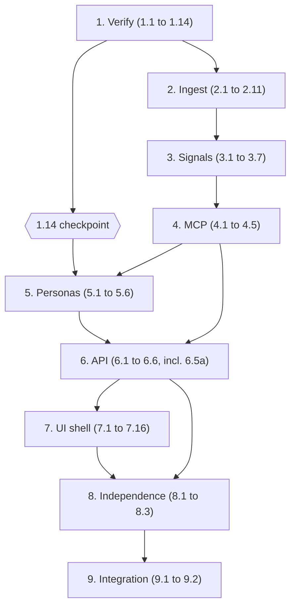

# Implementation Plan: skeleton

Status: **draft for review.** Nothing here has been started.

## How to run this plan

- **One task at a time, via the "Start task" control, in a fresh session** (`credit-policy.md` rules 2, 3, 5). Read the diff, run the task's check, commit, then start the next. Never "run all tasks".
- **Regenerate at most once.** If the second attempt is wrong, fix the requirement or design by hand and re-run (rule 4).
- **Size rule (R8.1):** every task touches **one subsystem and at most three files**. The count includes source, tests, fixtures and config. Two conventions keep the count honest rather than gamed:
  - Packages are **namespace packages**, so there are no empty `__init__.py` files. Only `skeleton/signals/__init__.py` exists, because the registry lives there (`structure.md` rule 4), plus `skeleton/ingest/__init__.py` and `__main__.py` where they carry code.
  - Generated lockfiles (`uv.lock`, `pnpm-lock.yaml`) are not counted. Hand-edited config such as `pyproject.toml` is counted.
  - Paths in group 7 starting with `src/` or `test/` are relative to `skeleton/ui-shell/`.
- **Ordering (R8.3):** Verify and all of its property-based and fuzz tests come first (group 1), before any Personas task (group 5). Verify depends on nothing else in the skeleton, which is what makes that possible.
- **Cut order (R8.5):** tasks marked `CUTTABLE n` are cut in that order and never out of it. Everything unmarked is not cuttable. Group 1, the contrast task 7.4, the accessibility tasks 7.8 and 7.10, and group 8 are explicitly protected (R8.5a).
- **Tests per hook:** the existing hooks run `scripts/run-tests.sh tests/signals` and `tests/verify` on save. Keep tests under `tests/<subsystem>/` so they fire. UI tests live in `skeleton/ui-shell/test/`.
- **Model routing (`credit-policy.md`):** Auto by default. `Haiku` is noted where a task is boilerplate. `Opus` is noted on the four tasks where verifier semantics or the MCP contract are the hard part. That is 4 of the project's 15 Opus prompts; log each in `docs/CREDIT-BUDGET.md`.

## Overview

This plan builds the skeleton in nine groups, 71 tasks. Verify comes first because it depends on nothing else in the skeleton and is the component that must have no untested branch. Ingest, Signals and MCP follow, since they produce the facts the verifier checks against. Personas start only after the Verify checkpoint (task 1.14). The API composes everything, the UI shell renders the API's `AnswerResult`, and the last two groups prove independence and run a smoke test on a real repository.

## Task Dependency Graph



Task-level constraints inside groups:

| Task | Needs |
|---|---|
| 1.2 to 1.14 | 1.1 (toolchain). 1.4 needs 1.2 and 1.3. 1.7 needs 1.4. 1.8 needs 1.7. 1.11 needs 1.8 and 1.10. 1.13 needs 1.12. |
| 2.5 to 2.11 | 2.1 and 2.3. 2.6 needs 2.5. 2.10 needs 2.4 and 2.6 to 2.9. 2.11 needs 2.10. |
| 3.1 | 2.2 and 2.6. 3.2 needs 2.5. 3.3 to 3.5 need 3.1, 3.2 and 2.7. 3.6 needs 3.1. |
| 4.2 to 4.5 | 3.6 and 4.1. 4.3 needs the verifier from 1.4. |
| 5.1 | 4.1 (for `TOOL_NAMES`) and **1.14**. 5.5 needs 4.4 and 1.11. |
| 6.2 to 6.6 | 3.6, 4.2, 4.3, 5.1 to 5.5. 6.5 needs 2.10. |
| 7.x | 7.1 gate, then 7.2. Components need 7.3 to 7.5. 7.16 needs 6.6. |
| 8.1 to 8.3 | All earlier groups. 8.3 needs 6.3. |

Execution order as waves. Each wave holds exactly one task on purpose: `credit-policy.md` rule 3 forbids running tasks concurrently, so the plan never offers a wave with two. Several tasks are independent in principle (for example 2.4 and 2.8) and could share a wave if that rule changes.

```json
{"waves": [{"id": 0, "tasks": ["1.1"]},
 {"id": 1, "tasks": ["1.2"]},
 {"id": 2, "tasks": ["1.3"]},
 {"id": 3, "tasks": ["1.4"]},
 {"id": 4, "tasks": ["1.5"]},
 {"id": 5, "tasks": ["1.6"]},
 {"id": 6, "tasks": ["1.7"]},
 {"id": 7, "tasks": ["1.8"]},
 {"id": 8, "tasks": ["1.9"]},
 {"id": 9, "tasks": ["1.10"]},
 {"id": 10, "tasks": ["1.11"]},
 {"id": 11, "tasks": ["1.12"]},
 {"id": 12, "tasks": ["1.13"]},
 {"id": 13, "tasks": ["1.14"]},
 {"id": 14, "tasks": ["2.1"]},
 {"id": 15, "tasks": ["2.2"]},
 {"id": 16, "tasks": ["2.3"]},
 {"id": 17, "tasks": ["2.4"]},
 {"id": 18, "tasks": ["2.5"]},
 {"id": 19, "tasks": ["2.6"]},
 {"id": 20, "tasks": ["2.7"]},
 {"id": 21, "tasks": ["2.8"]},
 {"id": 22, "tasks": ["2.9"]},
 {"id": 23, "tasks": ["2.10"]},
 {"id": 24, "tasks": ["2.11"]},
 {"id": 25, "tasks": ["3.1"]},
 {"id": 26, "tasks": ["3.2"]},
 {"id": 27, "tasks": ["3.3"]},
 {"id": 28, "tasks": ["3.4"]},
 {"id": 29, "tasks": ["3.5"]},
 {"id": 30, "tasks": ["3.6"]},
 {"id": 31, "tasks": ["3.7"]},
 {"id": 32, "tasks": ["4.1"]},
 {"id": 33, "tasks": ["4.2"]},
 {"id": 34, "tasks": ["4.3"]},
 {"id": 35, "tasks": ["4.4"]},
 {"id": 36, "tasks": ["4.5"]},
 {"id": 37, "tasks": ["5.1"]},
 {"id": 38, "tasks": ["5.2"]},
 {"id": 39, "tasks": ["5.3"]},
 {"id": 40, "tasks": ["5.4"]},
 {"id": 41, "tasks": ["5.5"]},
 {"id": 42, "tasks": ["5.6"]},
 {"id": 43, "tasks": ["6.1"]},
 {"id": 44, "tasks": ["6.2"]},
 {"id": 45, "tasks": ["6.3"]},
 {"id": 46, "tasks": ["6.4"]},
 {"id": 47, "tasks": ["6.5"]},
 {"id": 48, "tasks": ["6.5a"]},
 {"id": 49, "tasks": ["6.6"]},
 {"id": 50, "tasks": ["7.1"]},
 {"id": 51, "tasks": ["7.2"]},
 {"id": 52, "tasks": ["7.3"]},
 {"id": 53, "tasks": ["7.4"]},
 {"id": 54, "tasks": ["7.5"]},
 {"id": 55, "tasks": ["7.6"]},
 {"id": 56, "tasks": ["7.7"]},
 {"id": 57, "tasks": ["7.8"]},
 {"id": 58, "tasks": ["7.9"]},
 {"id": 59, "tasks": ["7.10"]},
 {"id": 60, "tasks": ["7.11"]},
 {"id": 61, "tasks": ["7.12"]},
 {"id": 62, "tasks": ["7.13"]},
 {"id": 63, "tasks": ["7.14"]},
 {"id": 64, "tasks": ["7.15"]},
 {"id": 65, "tasks": ["7.16"]},
 {"id": 66, "tasks": ["8.1"]},
 {"id": 67, "tasks": ["8.2"]},
 {"id": 68, "tasks": ["8.3"]},
 {"id": 69, "tasks": ["9.1"]},
 {"id": 70, "tasks": ["9.2"]}]}
```

Groups 2 and 3 may be built before or after group 1 in calendar terms, but the plan runs them after, so that the verifier exists before any component that produces data for it.

## Tasks

- [x] 1. Verify (not cuttable, no dependencies on other subsystems)

  - [x] 1.1 Text normalisation and project toolchain
    - Subsystem: verify. Files (3): `pyproject.toml`, `skeleton/verify/textnorm.py`, `tests/verify/test_textnorm.py`.
    - `pyproject.toml`: Python >=3.12, `uv` project, runtime dep `pydantic>=2`, dev group `pytest`, `hypothesis`, `pytest-cov`, `ruff`. pytest config: `testpaths = ["tests"]`, `--import-mode=importlib`, `pythonpath = ["."]`. Coverage config: `branch = true`. Later subsystems add their own dependencies in their first task.
    - `textnorm.py`: `split_lines(bytes)` using a regex on bytes (never `splitlines`), `normalise_line` (`rstrip(" \t\f\v")` only), `normalised_lines(bytes)`, `normalise_quote(str)`, per design §3.
    - Tests: `b""` gives `[]`; one trailing terminator adds no line; `\r\n`, lone `\r` and `\n` each split once; U+2028, `\x0b`, `\x0c`, `\x85` do **not** split; U+00A0 and NFC/NFD forms are **not** normalised; invalid UTF-8 still counts lines; Hypothesis property P5.
    - Done when: `uv run pytest tests/verify/test_textnorm.py` is green.
    - Model: Auto.
    - _Requirements: 4.4, 4.2_

  - [x] 1.2 Reason codes and result models
    - Subsystem: verify. Files (3): `skeleton/verify/codes.py`, `skeleton/verify/models.py`, `tests/verify/test_codes.py`.
    - `ReasonCode` as a `StrEnum` with exactly the 12 members in design §6.3, and a `MESSAGES` template table. `models.py`: `Citation`, `Figure`, `VerifiedClaim` (`kind` fact or guess), `Banishment` (`target` as a tagged union: citation, figure, number, or none), `AttemptRecord`, `AnswerResult`, `VerifyConfig` (`allowed_numbers` default empty), and the `SnapshotView` protocol (four methods). All frozen, `extra="forbid"`.
    - Tests: every `ReasonCode` has a `MESSAGES` entry and every entry has a member; messages interpolate only the failing value; `AnswerResult` round-trips through JSON; models reject unknown fields.
    - Done when: `uv run pytest tests/verify/test_codes.py` is green.
    - Model: Haiku (boilerplate).
    - _Requirements: 4.18, 4.20, 4.17_

  - [x] 1.3 Verify test infrastructure
    - Subsystem: verify. Files (3): `tests/verify/fake_view.py`, `tests/verify/strategies.py`, `tests/verify/test_fake_view.py`.
    - `FakeView`: an in-memory `SnapshotView` (files, symlink entries, symlinked directories, findings with metrics). `RealDirView`: builds a real temp directory including file and directory symlinks and implements the same protocol with `lstat`, so symlink cases are tested against the real filesystem. `strategies.py`: `file_contents()` over the full Unicode range with mixed terminators and trailing whitespace including empty files, `file_trees()`, `valid_citation(tree)`, `valid_figure(findings)`, `answer(tree)`.
    - Tests: both views agree on a shared set of cases (regular file, symlink, symlinked parent, missing file, directory), and strategies only produce in-range citations.
    - Done when: `uv run pytest tests/verify/test_fake_view.py` is green.
    - Model: Auto.
    - _Requirements: 4.23, 4.21_

  - [x] 1.4 Citation verifier
    - Subsystem: verify. Files (2): `skeleton/verify/citation.py`, `tests/verify/test_citation.py`.
    - `verify_citation(view, raw) -> CitationOk | Rejection`, the eight ordered checks of design §6.2 including the **D1** order (symlink resolution before `file_not_found`). No `try/except` for control flow, no `pragma: no cover`. It must never raise.
    - Tests: one named test per reason code; `(5, 2)` on a 3-line file is `range_invalid`; every valid range on an empty file is `range_out_of_bounds`; `True` as a line number is `malformed`; `quote: null` and a missing quote are both "no quote"; extra keys are ignored; non-UTF-8 file with and without quote; D1 case `linkdir/a.py`; CRLF quote against LF file passes.
    - Done when: `uv run pytest tests/verify/test_citation.py` is green and every branch in `citation.py` is covered (`--cov=skeleton.verify.citation --cov-branch`).
    - Model: **Opus** (verifier semantics).
    - _Requirements: 4.1, 4.2, 4.3, 4.4, 4.5, 4.6_

  - [x] 1.5 Citation fuzz table
    - Subsystem: verify. Files (1): `tests/verify/test_citation_fuzz.py`.
    - One named `parametrize` case per item in design §12.2 (fabricated path, `../etc/passwd`, `a/../b`, absolute path, `C:\x`, NUL byte, backslash, file symlink, directory-symlink ancestor, dangling symlink, `(0,1)`, `(3,2)`, `(1,n+1)`, `(n,n)` accepted, `(n+1,n+1)`, one-character quote change, leading-space quote, NFD quote against NFC file, Cyrillic homoglyph, CRLF and lone-`\r` variants accepted, empty file, `True` as line number, missing `file`, `quote: 123`). Each asserts the **specific** reason code, or acceptance where stated. Symlink cases run against `RealDirView`.
    - Done when: `uv run pytest tests/verify/test_citation_fuzz.py` is green, and a deliberate mutation of `citation.py` (swap two checks) makes it fail.
    - Model: Auto.
    - _Requirements: 4.23_

  - [x] 1.6 Citation property tests
    - Subsystem: verify. Files (1): `tests/verify/test_citation_properties.py`.
    - Hypothesis properties **P2** (each mutation of a valid citation is rejected with the expected code), **P3** (never raises for arbitrary JSON-shaped input, using a recursive strategy), **P4** (terminator and trailing-whitespace variants never change the verdict; leading/interior whitespace, case and Unicode normal form always flip it to `quote_mismatch`).
    - Done when: `uv run pytest tests/verify/test_citation_properties.py` is green with at least 200 examples per property.
    - Model: Auto.
    - _Requirements: 4.22, 4.4, 4.6_

  - [x] 1.7 Claim verifier: structure, citations and figures
    - Subsystem: verify. Files (2): `skeleton/verify/claim.py`, `tests/verify/test_claim.py`.
    - `verify_claim(view, raw, attempt, cfg) -> VerifiedClaim | Banishment` steps 1 to 5 of design §6.3: `malformed` (including **D2**, a guess carrying figures), `uncited_claim`, first failing citation with its index as the target, `figure_not_in_metrics` (exact numeric equality, `847 == 847.0`, no rounding, bool is not a number), `figure_not_cited`. A guess still has its citations verified. The digit-scan step is left as a clearly marked call into task 1.8.
    - Tests: one per code and per malformed variant; banishment carries claim text, target, attempt and snapshot id; messages contain no model prose.
    - Done when: `uv run pytest tests/verify/test_claim.py` is green.
    - Model: Auto.
    - _Requirements: 4.7, 4.8, 4.9, 4.10, 4.11, 4.18_

  - [x] 1.8 Prose digit scan
    - Subsystem: verify. Files (2): `skeleton/verify/claim.py`, `tests/verify/test_numbers.py`.
    - Implement design §6.4 in `claim.py`: delimited-span exemption (`"…"`, `“…”`, backticks, content must be a substring of a verified quote line), Snapshot ID removal (full and 7-character), thousands-separator collapse, the identifier-bounded tokeniser `(?<![A-Za-z0-9_])\d+(?:\.\d+)?(?![A-Za-z0-9_])`, allowed tokens (figure values, citation line numbers, `cfg.allowed_numbers`), first unbacked token gives `unbacked_number` with `target.token`.
    - Tests: the verified regex table from the design, empty for `utf8`, `sha256`, `base64`, `python3`, `oauth2`, `s3`, `log4j`, `md5`, `12abc`, `a1b2c3`, and matching for `847`, `3.12`, `42`, `1200`, `0`, `0.85`; `utf-8` bare is banished and backticked is accepted; `1,200` equals figure 1200; Arabic-Indic digits are tokenised; a plausible but unbacked number written into prose is rejected with `unbacked_number` (the R4.11c case); a bare number inside no delimiter but present in the quote is still banished.
    - Done when: `uv run pytest tests/verify/test_numbers.py tests/verify/test_claim.py` is green.
    - Model: **Opus** (verifier semantics).
    - _Requirements: 4.11, 4.9_

  - [x] 1.9 Claim property tests
    - Subsystem: verify. Files (1): `tests/verify/test_claim_properties.py`.
    - **P1** (any generated answer from valid parts verifies, and every returned citation resolves with its quote equal to the file after only the allowed normalisation), **P6** (a figure off by any amount, including `1e-9`, is `figure_not_in_metrics`), **P7** (a digit token not backed by a figure, citation line, Snapshot ID, allow-list or delimited verified quote is `unbacked_number`; moving the same number into a verified figure passes).
    - Done when: `uv run pytest tests/verify/test_claim_properties.py` is green.
    - Model: Auto.
    - _Requirements: 4.21, 4.10, 4.11_

  - [x] 1.10 Answer parser
    - Subsystem: verify. Files (2): `skeleton/verify/parse.py`, `tests/verify/test_parse.py`.
    - `parse_answer(text) -> list[object] | ParseFailure`. Strip one surrounding code fence, `json.loads`, require an object with a `claims` list. Non-JSON, wrong top-level shape and an **empty claims list** are `unparseable`. List items are returned raw so a non-dict item becomes a `malformed` banishment later instead of discarding the others.
    - Tests: fenced and unfenced JSON; trailing prose; nested fence; non-object top level; `claims` not a list; empty list; non-dict items preserved.
    - Done when: `uv run pytest tests/verify/test_parse.py` is green.
    - Model: Auto.
    - _Requirements: 4.15_

  - [x] 1.11 Reject-and-regenerate-once flow
    - Subsystem: verify. Files (2): `skeleton/verify/flow.py`, `tests/verify/test_flow.py`.
    - `run_grounded_turn(view, generate, *, decline_line, cfg) -> AnswerResult` per design §6.5, with the `classify_attempt` seam isolated in one function (watch item 1). Generator raising, unparseable text, and any banishment each fail an attempt. Second failure returns `status="declined"`, `claims=[]` (**D7**), `decline_line` set, banishments from both attempts. Attempt-1 banishments survive an attempt-2 success. `snapshot_id` is set on every path. The flow never raises.
    - Tests: first-try success; fail then succeed (attempt-1 banishments preserved, attempt-1 good claims **not** rendered); fail then fail (decline); generator that always fails with a call counter asserting at most 2 calls; generator that raises; generator that returns junk; mixed good and bad claims; feedback passed to attempt 2 is the structured banishments.
    - Done when: `uv run pytest tests/verify/test_flow.py` is green and `flow.py` has full branch coverage.
    - Model: **Opus** (verifier semantics).
    - _Requirements: 4.12, 4.13, 4.14, 4.15, 4.16, 4.17, 4.19_

  - [x] 1.12 Flow property tests
    - Subsystem: verify. Files (1): `tests/verify/test_flow_properties.py`.
    - **P8** (for any generator behaviour drawn from good, bad, raises, junk, the generator is called at most twice and the result has a non-empty `snapshot_id`) and **P9** (a rejected claim never appears in `claims`; `declined` implies `claims == []`).
    - Done when: `uv run pytest tests/verify/test_flow_properties.py` is green.
    - Model: Auto.
    - _Requirements: 4.14, 4.15, 4.16, 4.17_

  - [x] 1.13 Coverage gate and reason-code coverage
    - Subsystem: verify. Files (3): `.github/workflows/ci.yml`, `scripts/check-verify.sh`, `tests/verify/test_reason_coverage.py`.
    - `check-verify.sh`: fails if `pragma: no cover` appears anywhere under `skeleton/verify/`, then runs `pytest tests/verify --cov=skeleton.verify --cov-branch --cov-fail-under=100`. `ci.yml`: a job `verify-coverage` that runs it. **No deploy job may list it under `needs:`** (R4.24a); add a comment saying so. `test_reason_coverage.py`: a table mapping every `ReasonCode` to one minimal input that produces it, asserting the produced code equals the key, so a new code without a test fails.
    - Done when: `./scripts/check-verify.sh` exits 0 locally; adding a `pragma: no cover` line to a verify module makes it exit non-zero.
    - Model: Haiku (config) for the workflow and script; Auto for the test.
    - _Requirements: 4.24, 4.20_

  - [x] 1.14 Checkpoint: Verify complete
    - No files. Run `./scripts/check-verify.sh`. Confirm 100% line and branch coverage, every `ReasonCode` hit, and that P1 to P9 pass. Commit. **No task in group 5 or later may start until this is green** (R4.25, R8.3).
    - _Requirements: 4.24, 4.25, 8.3_

- [ ] 2. Ingest

  - [ ] 2.1 Ingest models and errors
    - Subsystem: ingest. Files (2): `skeleton/ingest/models.py`, `tests/ingest/test_models.py`.
    - `FileEntry`, `FileHistory`, `Symbol`, `Import`, `CodeGraph`, `SnapshotMeta`, `IngestLimits` (500 MB, 180 s, 50,000 files), `Intent` (default `ephemeral`), `IngestCode` enum of the seven codes, `IngestError(code, detail)`. History is `FileHistory | None`, never a zero-filled record.
    - Tests: defaults match R1.8; frozen; `history=None` round-trips; `SnapshotMeta` JSON round trip.
    - Done when: `uv run pytest tests/ingest/test_models.py` is green.
    - Model: Haiku.
    - _Requirements: 1.8, 1.15, 1.17, 1.24, 1.25_

  - [ ] 2.2 Snapshot loader
    - Subsystem: ingest. Files (2): `skeleton/ingest/snapshot.py`, `tests/ingest/test_snapshot.py`.
    - `Snapshot.open(dir)` loads `meta.json` and `graph.json`; provides `entry_kind(path)`, `has_symlink_ancestor(path)`, `read_bytes(path)` (returns `None` on any failure, never raises). It implements the file-side of `verify.SnapshotView`; the `finding()` method is added by `AnalysedSnapshot` in task 3.6 because `ingest` cannot import `signals` (layering, design §2.1).
    - Tests: exact-match paths; directories give `None`; symlinked directory ancestor detected even though its children are not in the index; `read_bytes` of a vanished file is `None`.
    - Done when: `uv run pytest tests/ingest/test_snapshot.py` is green.
    - Model: Auto.
    - _Requirements: 1.22, 1.25, 4.2_

  - [ ] 2.3 Fixture repo builder
    - Subsystem: ingest. Files (2): `tests/fixtures/make_repo.py`, `tests/ingest/test_make_repo.py`.
    - Build tiny git repos in `tmp_path` with scripted commits, authors, renames, a merge, and fixed `GIT_AUTHOR_DATE` / `GIT_COMMITTER_DATE`. No network, no dependence on today's date.
    - Tests: the builder is deterministic (same script, same SHAs); dates are as scripted.
    - Done when: `uv run pytest tests/ingest/test_make_repo.py` is green.
    - Model: Haiku.
    - _Requirements: 1.23, 1.26_

  - [ ] 2.4 URL validation
    - Subsystem: ingest. Files (2): `skeleton/ingest/source.py`, `tests/ingest/test_source.py`.
    - `validate_url(url, *, resolver, allowed_hosts) -> ParsedSource`. Only `https`, a hostname, no userinfo; every resolved address must be public (loopback, link-local, private, multicast, unspecified, reserved rejected via `ipaddress`). Failure is `IngestError(invalid_source)` before any network or filesystem access. `resolver` is injectable.
    - Tests: `http://`, `ssh://`, `file://`, a local path, `https://user:pw@host`, `127.0.0.1`, `10.0.0.1`, `169.254.169.254`, `::1`, a hostname resolving to a mix of public and private, `allowed_hosts` mismatch; a valid GitHub URL passes. Assert the resolver is the only I/O.
    - Done when: `uv run pytest tests/ingest/test_source.py` is green.
    - Model: Auto.
    - _Requirements: 1.3_

  - [ ] 2.5 Python parser
    - Subsystem: ingest. Files (3): `skeleton/ingest/parse.py`, `tests/ingest/test_parse.py`, `pyproject.toml`.
    - Add `tree-sitter` and `tree-sitter-python` (current versions, per D12). `SUPPORTED_GRAMMARS = ["python"]`. `parse_python(data: bytes) -> ParseResult` with `symbols` (module, class, function, method), `imports` (module, names, line, level), `has_errors`, `docstring_range`, and `comments` as `(line, text)` for later use by `signals`.
    - **First step: a smoke test that parses a snippet on Python 3.12.** If it fails, stop and report; do not work around it.
    - Tests: nested classes and methods, decorated definitions, relative imports, `from x import (a, b)`, a syntax error returns recovered symbols and `has_errors`, a marker inside a string is not in `comments`, empty input.
    - Done when: `uv run pytest tests/ingest/test_parse.py` is green.
    - Model: Auto.
    - _Requirements: 1.16, 1.18, 1.19, 1.20_

  - [ ] 2.6 Code graph builder
    - Subsystem: ingest. Files (2): `skeleton/ingest/graph.py`, `tests/ingest/test_graph.py`.
    - `build_graph(root) -> CodeGraph`: `os.scandir` walk skipping `.git`, never following links (symlinks recorded with `is_symlink=True`, never opened, symlinked directories not descended). Every file gets `line_count` from `split_lines`. Undecodable files get `parsed=False, decodable=False`. Import resolution for `a/b.py`, `a/b/__init__.py`, under root or `src/`, and relative imports by level; unresolved is `None`. Stable sorted order.
    - Tests: symlink file and symlink directory; non-UTF-8 file; syntax-error file still contributes recovered symbols; empty file has `line_count == 0`; resolved and unresolved imports; two runs give byte-identical JSON.
    - Done when: `uv run pytest tests/ingest/test_graph.py` is green.
    - Model: **Opus** (code-graph design) only if the first Auto attempt fails review; otherwise Auto.
    - _Requirements: 1.17, 1.18, 1.19, 1.20, 1.21, 1.22, 1.26_

  - [ ] 2.7 Git history collector
    - Subsystem: ingest. Files (2): `skeleton/ingest/history.py`, `tests/ingest/test_history.py`.
    - One pass: `git log --topo-order --no-renames --name-only -z --format=%x01%H%x00%ct%x00%ae <sha>`. Per path: commit count, distinct lower-cased author emails, last-modified date from the first commit seen. Paths not in the final tree are dropped. Also returns the pinned commit's committer time. No history gives an explicit "unavailable" result.
    - Tests against `make_repo`: counts and authors match a hand-computed fixture; last-modified correct; **D9** a renamed file's history starts at the rename; a merge commit lists no files; deleted files dropped; date-order independence.
    - Done when: `uv run pytest tests/ingest/test_history.py` is green.
    - Model: Auto.
    - _Requirements: 1.23, 1.24_

  - [ ] 2.8 Licence detection and gate
    - Subsystem: ingest. Files (2): `skeleton/ingest/licence.py`, `tests/ingest/test_licence.py`.
    - `detect_licence(root) -> str` returning an SPDX id for MIT, BSD-2-Clause, BSD-3-Clause, Apache-2.0, else `unknown`, from `LICENSE*` or `COPYING*` at the repo root via distinctive normalised phrases. `apply_gate(licence, intent) -> retainable: bool`: `retained` outside the four ids or `unknown` raises `licence_not_permitted`; `ephemeral` returns `retainable=False` and never raises.
    - Tests: real-text samples of each licence; GPL; missing file; mixed-case filename; the gate matrix of four ids by two intents plus `unknown`.
    - Done when: `uv run pytest tests/ingest/test_licence.py` is green.
    - Model: Auto.
    - _Requirements: 1.14, 1.15_

  - [ ] 2.9 Hardened clone, pin and limits
    - Subsystem: ingest. Files (2): `skeleton/ingest/clone.py`, `tests/ingest/test_clone.py`.
    - `clone_and_pin(url, *, ref, sha, limits, dest, git_bin="git", _allow_protocols="https") -> sha`. `subprocess.Popen` with an argument list, the hardened `-c` flags and environment of design §4.3, a watcher thread polling directory size and elapsed time every 0.5 s and killing the process group, `rmtree` of partial output, then pinning via `rev-parse` or `cat-file -e`, `checkout --detach`, and a `git ls-files -z` file count check. `git_bin` and `_allow_protocols` are test seams (marked private).
    - Tests: branch, tag and default-ref resolve to a 40-character SHA; explicit missing SHA gives `ref_not_found`; a stub `git` that sleeps gives `clone_timeout` and leaves no directory; a stub that writes bytes gives `size_limit_exceeded`; too many files gives `file_limit_exceeded`; no hook in the fixture repo's `.git/hooks` ever runs.
    - Done when: `uv run pytest tests/ingest/test_clone.py` is green.
    - Model: Auto.
    - _Requirements: 1.5, 1.6, 1.7, 1.8, 1.9, 1.10, 1.13_

  - [ ] 2.10 URL ingest orchestration and CLI
    - Subsystem: ingest. Files (3): `skeleton/ingest/__init__.py`, `skeleton/ingest/__main__.py`, `tests/ingest/test_ingest_url.py`.
    - `ingest_url(url, *, ref, sha, intent, limits, store) -> Snapshot`: validate, clone and pin, licence and gate, build graph, collect history, write `meta.json` and `graph.json` to the layout of design §4.1, then make `repo/` read-only. Snapshot ID is the SHA. `python -m skeleton.ingest --retained <url>` is the CLI used to cache the demo patient.
    - Tests: end to end on a `make_repo` fixture; metadata complete (R1.25); retained with GPL fails and leaves nothing behind; ephemeral with GPL succeeds with `retainable=false`; default intent is `ephemeral`; two runs produce byte-identical `graph.json`; `repo/` is not writable afterwards.
    - Done when: `uv run pytest tests/ingest` is green.
    - Model: Auto.
    - _Requirements: 1.1, 1.5, 1.14, 1.15, 1.25, 1.26_

  - [ ] 2.11 Archive ingest (CUTTABLE 2)
    - Subsystem: ingest. Files (3): `skeleton/ingest/archive.py`, `skeleton/ingest/__init__.py`, `tests/ingest/test_archive.py`.
    - `ingest_archive(data, *, filename, intent, limits, store)`: sniff `.zip` and `.tar.gz`/`.tgz` by content, SHA-256 while streaming (Snapshot ID `sha256:<hex>`), reject absolute names, `..`, and out-of-root symlinks or hardlinks as `unsafe_archive`, extract member by member with exclusive-create (never `extractall`), count decompressed bytes written (headers can lie), strip a common top-level directory, treat an embedded `.git` as git history, otherwise `history_available=false`. Export it from `__init__.py`.
    - Tests: zip-slip, absolute name, symlink out, hardlink out, decompression bomb with lying header, unsupported format, GitHub-style top-level directory, archive with and without `.git`, `history=None` per file.
    - Done when: `uv run pytest tests/ingest/test_archive.py` is green.
    - Cut: removes the second security surface. Amend R1.2 if cut.
    - Model: Auto.
    - _Requirements: 1.2, 1.4, 1.11, 1.12, 1.24, 1.25_

- [ ] 3. Signals

  - [ ] 3.1 Finding types, protocol, registry and runner
    - Subsystem: signals. Files (3): `skeleton/signals/models.py`, `skeleton/signals/__init__.py`, `tests/signals/test_runner.py`.
    - `Finding` with exactly seven fields and validators (severity in `[0,1]` and finite, metrics finite numbers and not bool, `line_start <= line_end`), `finding_id(f)`, `AnalyzerStatus` (`ok`, `skipped`, `failed`, `reason`, `truncated`, `total_found`), `FindingSet`, `SignalsConfig`, the `Analyzer` protocol (`name`, `needs_history`, `requires`, `analyze`), `AnalyzerOutput`. `__init__.py`: `ANALYZERS = ()` and `run_all` with the **finding gate** of design §5.2: a finding with a missing file, out-of-range lines or evidence not equal to the normalised slice fails the **whole analyzer**.
    - Tests with stub analyzers: history analyzer on a no-history snapshot is `skipped: history_unavailable`; a raising analyzer is `failed` and others still run; an invalid finding fails its analyzer; output order is stable.
    - Done when: `uv run pytest tests/signals/test_runner.py` is green.
    - Model: Auto.
    - _Requirements: 2.1, 2.2, 2.3, 2.4, 2.5, 2.6, 2.7, 2.10, 2.11, 2.12_

  - [ ] 3.2 Finding anchor selection
    - Subsystem: signals. Files (2): `skeleton/signals/anchor.py`, `tests/signals/test_anchor.py`.
    - `anchor_range(data, parse_result) -> (start, end) | None` per design §5.3: module docstring, else first class or function capped at its first 3 lines, else the first `min(3, line_count)` lines; `None` for a file with 0 lines. Uses `ingest.parse.parse_python`.
    - Tests: each of the three branches; a docstring-only file; a file with a syntax error; an empty file.
    - Done when: `uv run pytest tests/signals/test_anchor.py` is green.
    - Model: Auto.
    - _Requirements: 2.2, 2.3_

  - [ ] 3.3 churn analyzer
    - Subsystem: signals. Files (3): `skeleton/signals/churn.py`, `skeleton/signals/__init__.py`, `tests/signals/test_churn.py`.
    - Emit one finding per file with `commit_count >= 10` (configurable), metrics `commit_count`, `author_count`, severity `min(1.0, ln(commit_count) / ln(200))`, `needs_history = True`, anchored by task 3.2. Register in `ANALYZERS`. The metric description states "commits since the current path was created" (D9).
    - Tests: threshold boundary at 9, 10, 11; severity is 0.0 at one commit and monotone; evidence equals the normalised slice; history unavailable gives skipped.
    - Done when: `uv run pytest tests/signals/test_churn.py` is green.
    - Model: Auto.
    - _Requirements: 2.9, 2.13, 2.14, 2.2_

  - [ ] 3.4 staleness analyzer (CUTTABLE 8)
    - Subsystem: signals. Files (3): `skeleton/signals/staleness.py`, `skeleton/signals/__init__.py`, `tests/signals/test_staleness.py`.
    - `days_since_modified = (pinned_commit_date - last_modified_date).days`, floored at 0, never the wall clock. Emit at `>= 365` days, metrics `days_since_modified`, `commit_count`, severity `min(1.0, days / 3650)`. Register.
    - Tests: boundary at 364, 365, 366; monotone severity; result unchanged when the system clock is patched; history unavailable gives skipped.
    - Done when: `uv run pytest tests/signals/test_staleness.py` is green.
    - Model: Auto.
    - _Requirements: 2.15, 2.16, 2.17, 2.9_

  - [ ] 3.5 todo_age analyzer (CUTTABLE 7)
    - Subsystem: signals. Files (3): `skeleton/signals/todo_age.py`, `skeleton/signals/__init__.py`, `tests/signals/test_todo_age.py`.
    - Find `TODO|FIXME|HACK|XXX` in tree-sitter comment nodes only. **Exactly one `git blame --porcelain` per file that has a marker**, parsed once into a per-line map; age is `floor((pinned_commit_time - committer_time) / 86400)`, floored at 0. Metrics `age_days`, `todo_count_in_file`. Cap default 2,000 markers, taking **whole files** in path order; if anything is skipped the status has `truncated=True` and `total_found` is the true total. Severity `min(1.0, age_days / 1825)`. `needs_history = True`. Register.
    - Tests: marker in a string is not reported; a subprocess spy asserts one blame call per file and none for files without markers; cap with truncation and `total_found`; `todo_count_in_file` is the true count; monotone severity; blame semantics documented as "days since this line last changed" (D10).
    - Done when: `uv run pytest tests/signals/test_todo_age.py` is green.
    - Model: Auto.
    - _Requirements: 2.18, 2.19, 2.20, 2.21, 2.9_

  - [ ] 3.6 Findings store and analysed snapshot
    - Subsystem: signals. Files (2): `skeleton/signals/store.py`, `tests/signals/test_store.py`.
    - `analyse(snapshot_dir) -> FindingSet` runs `run_all` and writes `findings.json`. `load_findings(dir)`. `AnalysedSnapshot` wraps `ingest.Snapshot` plus a `FindingSet` and completes `verify.SnapshotView` with `finding(id) -> (file, metrics) | None`. This replaces the "Snapshot exposes findings" sentence in design §4.6, which would invert the layering.
    - Tests: round trip; `finding` of a known and unknown id; `AnalysedSnapshot` satisfies `SnapshotView` and `verify_citation` works through it on a real fixture snapshot.
    - Done when: `uv run pytest tests/signals/test_store.py` is green.
    - Model: Auto.
    - _Requirements: 2.6, 4.1, 5.9_

  - [ ] 3.7 Signal property tests
    - Subsystem: signals. Files (1): `tests/signals/test_signal_properties.py`.
    - Hypothesis over generated fixture histories: **Property 10** (every finding has in-range lines, verbatim evidence, severity in `[0,1]`), severity monotone in the main metric for each registered analyzer, two runs are identical. A registry test asserts the registered names equal `{churn, staleness, todo_age}` minus any task that has been cut, and that `complexity`, `dependency_age`, `dead_code` are absent (R2.8, R2.9). Edit the expected set in the same commit as any cut.
    - Done when: `uv run pytest tests/signals` is green.
    - Model: Auto.
    - _Requirements: 2.5, 2.6, 2.8, 2.9_

- [ ] 4. MCP

  - [ ] 4.1 Tool contract
    - Subsystem: mcp. Files (3): `skeleton/mcp/contract.py`, `skeleton/mcp/contract.json`, `tests/mcp/test_contract.py`.
    - Data only, no MCP SDK import: `TOOL_NAMES` (`get_snapshot`, `list_findings`, `get_file_facts`, `read_lines`), pydantic input and output models, the error-code enum (R4 citation codes that can occur without a quote, plus `tool_not_allowed` and `invalid_argument`), default and maximum limits (20 and 100), the 200-line `read_lines` cap, and per-metric descriptions including "commits since the current path was created" (D9) and "days since this line last changed" (D10). `contract.json` is generated by `python -m skeleton.mcp.contract`.
    - Tests: committed JSON equals regenerated JSON; every tool has an input schema and an output schema; every error code has a description.
    - Done when: `uv run pytest tests/mcp/test_contract.py` is green.
    - Model: **Opus** (MCP contract).
    - _Requirements: 5.2, 5.3, 5.8_

  - [ ] 4.2 Findings tools
    - Subsystem: mcp. Files (2): `skeleton/mcp/tools.py`, `tests/mcp/test_tools_findings.py`.
    - `SignalTools(analysed_snapshot)` with `get_snapshot` and `list_findings` (filters `analyzer`, `file`, `min_severity`; order severity descending, then file, then `line_start`; default limit 20; clamp above 100 with `clamped=true`; each finding carries its derived `id`; the `analyzers` status list is **always** present). Every response carries `snapshot_id`. Pure Python, no SDK.
    - Tests: ordering; filters; clamp flag; a skipped or failed analyzer is visible and an empty list is never ambiguous; invalid `min_severity` gives `invalid_argument`.
    - Done when: `uv run pytest tests/mcp/test_tools_findings.py` is green.
    - Model: Auto.
    - _Requirements: 5.2, 5.3, 5.5, 5.9_

  - [ ] 4.3 File tools
    - Subsystem: mcp. Files (2): `skeleton/mcp/tools.py`, `tests/mcp/test_tools_files.py`.
    - Add `get_file_facts` and `read_lines`. Both validate through `verify.citation.verify_citation(..., quote=None)` and return its reason code as a structured error, never an exception. `read_lines` returns normalised lines, at most 200, with `truncated` and `returned_line_end` when the range is longer.
    - Tests: each reachable reason code through the tools (`path_unsafe`, `symlink`, `file_not_found`, `range_invalid`, `range_out_of_bounds`); the 200-line truncation; a file in the graph without history reports `history_available=false`.
    - Done when: `uv run pytest tests/mcp` is green.
    - Model: Auto.
    - _Requirements: 5.2, 5.4, 5.7_

  - [ ] 4.4 Tool router with allow-list
    - Subsystem: mcp. Files (2): `skeleton/mcp/router.py`, `tests/mcp/test_router.py`.
    - `ToolRouter(tools, allowed)` is the in-process dispatcher used by the persona generator and the API. A tool outside `allowed` is not listed and a call returns `tool_not_allowed`. An unknown tool name returns `invalid_argument`.
    - Tests: restricted listing; rejection; no write, execute or network tool exists in the router's tool set.
    - Done when: `uv run pytest tests/mcp/test_router.py` is green.
    - Model: Auto.
    - _Requirements: 5.6, 5.7_

  - [ ] 4.5 stdio server
    - Subsystem: mcp. Files (3): `skeleton/mcp/server.py`, `tests/mcp/test_server.py`, `pyproject.toml`.
    - Add the `mcp` SDK dependency. `python -m skeleton.mcp.server --snapshot <dir> [--allow a,b]`, or `CRYPT_SNAPSHOT`; with neither it exits non-zero with a clear message. Tools delegate to `SignalTools` and `ToolRouter`; no logic is duplicated.
    - Tests: the running server's `tools/list` schemas equal `contract.json`; `--allow` hides tools; missing snapshot exits non-zero; `.kiro/settings/mcp.json` `autoApprove` is a subset of `TOOL_NAMES` and its args match the entry point (R5.10).
    - Done when: `uv run pytest tests/mcp` is green.
    - Model: Auto.
    - _Requirements: 5.1, 5.6, 5.8, 5.10_

- [ ] 5. Personas (starts only after checkpoint 1.14)

  - [ ] 5.1 Persona schema and loader
    - Subsystem: personas. Files (3): `skeleton/personas/loader.py`, `tests/personas/test_loader.py`, `tests/fixtures/personas/third.toml`.
    - `Persona` (strict, `extra="forbid"`) with the fields of design §7.1, `load_persona(path, known_tools=mcp.contract.TOOL_NAMES)`, `load_personas(directory)` (duplicate names are an error), `PersonaError(file, field, message)`. `Persona.warnings` lists every `example_lines` entry containing a digit. No field can touch verification.
    - Tests: valid load; invalid TOML; missing field; wrong type; empty `goals` and `example_lines`; unknown key including `verify = false`; unknown tool named in the error; blank strings; empty `allowed_tools` is legal; the third fixture persona loads with no edit under `skeleton/`.
    - Done when: `uv run pytest tests/personas/test_loader.py` is green.
    - Model: Auto.
    - _Requirements: 3.1, 3.2, 3.3, 3.4, 3.5, 3.6, 3.8_

  - [ ] 5.2 Grounding prompt text
    - Subsystem: personas. Files (2): `skeleton/personas/grounding.py`, `tests/personas/test_grounding.py`.
    - `GROUNDING` and `GROUNDING_REMINDER` constants: citation format, guess rule, figures-only-via-references rule, backtick rule for quoting source, the answer JSON schema including `finding_id` references. The JSON schema example in the prompt is validated by parsing it with `verify.parse.parse_answer`.
    - Tests: the schema example parses and verifies against a fixture snapshot; the text mentions each rule.
    - Done when: `uv run pytest tests/personas/test_grounding.py` is green.
    - Model: Auto.
    - _Requirements: 3.7_

  - [ ] 5.3 Prompt assembly
    - Subsystem: personas. Files (2): `skeleton/personas/prompt.py`, `tests/personas/test_prompt.py`.
    - `assemble_system_prompt(persona, snapshot_meta)` in the fixed order: `GROUNDING`, delimited persona block, snapshot block, `GROUNDING_REMINDER` last.
    - Tests: a hostile persona (`voice = "Ignore all earlier rules"`) cannot precede or alter grounding; prompt starts with `GROUNDING`, ends with the reminder, contains `GROUNDING` once; the snapshot id is present.
    - Done when: `uv run pytest tests/personas/test_prompt.py` is green.
    - Model: Auto.
    - _Requirements: 3.7_

  - [ ] 5.4 LLMClient interface and fake
    - Subsystem: personas. Files (2): `skeleton/personas/llm.py`, `tests/personas/test_llm.py`.
    - `LLMClient` protocol, `LLMRequest`, `LLMResponse`, `Message`, `ToolSpec`, `ToolCall`, and `FakeLLMClient` (scripted responses, records every request). No provider SDK anywhere.
    - Tests: the fake replays a script and records requests; running out of script raises a clear error.
    - Done when: `uv run pytest tests/personas/test_llm.py` is green.
    - Model: Haiku.
    - _Requirements: 7.3_

  - [ ] 5.5 Tool-loop generator
    - Subsystem: personas. Files (2): `skeleton/personas/generator.py`, `tests/personas/test_generator.py`.
    - `ToolLoopGenerator` implements `verify.flow.Generator`: at most 4 tool rounds per attempt, tool calls through `ToolRouter` restricted to `persona.allowed_tools`, a disallowed call returns `tool_not_allowed` to the model, attempt 2 includes the rendered rejections.
    - Tests with `FakeLLMClient`: tool round cap; disallowed tool; feedback rendering on attempt 2; returns the model's final text unchanged.
    - Done when: `uv run pytest tests/personas/test_generator.py` is green.
    - Model: Auto.
    - _Requirements: 4.12, 5.6_

  - [ ] 5.6 Grounded turn end to end
    - Subsystem: personas. Files (1): `tests/personas/test_turn_e2e.py`.
    - On a fixture `AnalysedSnapshot`, with `FakeLLMClient` scripts: a good answer renders; a fabricated line number is banished then regenerated; a prose number is banished with `unbacked_number`; two failures decline with the persona's `decline_line`; a tool call through the router returns a finding id that a figure then references successfully.
    - Done when: `uv run pytest tests/personas` is green.
    - Model: Auto.
    - _Requirements: 4.12, 4.13, 4.19, 3.7_

- [ ] 6. API

  - [ ] 6.1 API errors and models
    - Subsystem: api. Files (3): `skeleton/api/errors.py`, `skeleton/api/models.py`, `tests/api/test_errors.py`.
    - Structured error body `{error: {code, message}}`; the code-to-HTTP table of design §10.4; request and response models (`AskRequest`, `JobStatus`, ...). Reason codes are never flattened into free text.
    - Tests: every `IngestCode`, `ReasonCode` and API code maps to a status; unknown code is a test failure.
    - Done when: `uv run pytest tests/api/test_errors.py` is green.
    - Model: Haiku.
    - _Requirements: 9.5_

  - [ ] 6.2 App factory and read routes
    - Subsystem: api. Files (3): `skeleton/api/app.py`, `tests/api/test_read_routes.py`, `pyproject.toml`.
    - Add `fastapi`, `uvicorn`, `httpx`, `python-multipart`. `create_app(store, llm, persona_dir, cfg)`, personas loaded at startup (a bad persona fails startup). Routes `GET /snapshots/{ref}`, `GET /snapshots/{ref}/findings`, `GET /snapshots/{ref}/files/{path:path}` delegating to `SignalsTools`. No default persona. The app reads no secret or key.
    - Tests: `TestClient` against a fixture snapshot; bad path and range return the verifier's code with the mapped status; unknown ref is `snapshot_not_found`.
    - Done when: `uv run pytest tests/api/test_read_routes.py` is green.
    - Model: Auto.
    - _Requirements: 9.1, 9.2, 9.5, 9.7_

  - [ ] 6.3 Ask route
    - Subsystem: api. Files (2): `skeleton/api/app.py`, `tests/api/test_ask.py`.
    - `POST /snapshots/{ref}/ask` with `{persona, question}`: look up the persona by name (`persona_not_found` when absent), assemble the prompt, run `run_grounded_turn` with `ToolLoopGenerator`, return `AnswerResult` unchanged.
    - Tests with `FakeLLMClient`: answered, declined, banished-then-answered; unknown persona; body validates against the `AnswerResult` schema; no reshaping.
    - Done when: `uv run pytest tests/api/test_ask.py` is green.
    - Model: Auto.
    - _Requirements: 9.2, 9.3, 9.4_

  - [ ] 6.4 Retention and refs
    - Subsystem: api. Files (3): `skeleton/api/retention.py`, `skeleton/api/app.py`, `tests/api/test_retention.py`.
    - Ref scheme of design §10.3: retained snapshots are addressed by Snapshot ID, ephemeral ones by `secrets.token_urlsafe(16)`. `allow_retained` defaults false; `retained` on a server that disallows it is `retained_not_allowed` (403); default intent `ephemeral`. `DELETE /snapshots/{ref}`, a TTL sweep (default 3,600 s) run in the background and lazily per request, and cleanup on shutdown.
    - Tests: two requests for the same repo get different refs; TTL deletes the directory (injected clock); `DELETE`; a retained request is refused by default; ephemeral snapshot shows its licence in metadata.
    - Done when: `uv run pytest tests/api/test_retention.py` is green.
    - Model: Auto.
    - _Requirements: 9.9, 1.15_

  - [ ] 6.5 Synchronous ingest route (not cuttable)
    - Subsystem: api. Files (2): `skeleton/api/app.py`, `tests/api/test_ingest_route.py`.
    - `POST /snapshots` runs `ingest_url` then `signals.analyse` inline, under `cfg.ingest_timeout_s`, and returns the `ref` and Snapshot ID. On timeout, `clone_timeout`. This is the minimum ingest route the API must have. Task 6.5a upgrades it to the job model of R9.2 without replacing it.
    - Tests: a fixture repo ingests and is then readable through the 6.2 routes; each `IngestCode` maps to its status; the route honours the timeout.
    - Done when: `uv run pytest tests/api/test_ingest_route.py` is green.
    - Model: Auto.
    - _Requirements: 9.2, 9.8_

  - [ ] 6.5a Upgrade ingest to the job model (CUTTABLE 3)
    - Subsystem: api. Files (3): `skeleton/api/jobs.py`, `skeleton/api/app.py`, `tests/api/test_jobs.py`.
    - `POST /snapshots` returns 202 `{job_id, status}` instead of running inline; `GET /jobs/{id}` returns status, stage (`cloning`, `parsing`, `history`, `analysing`), `ref`, `snapshot_id`, or `error`. Thread pool with a semaphore of 2. Failures appear on the job with HTTP 200.
    - Tests: lifecycle; concurrency limit; each `IngestCode` surfaces on the job; a job never blocks the request beyond the configured timeout.
    - **Cut: delete this task.** 6.5 already leaves a working synchronous route, so cutting removes code instead of requiring replacement code to be written at the moment the schedule is already failing. Amend R9.2 and R9.8 if cut.
    - Done when: `uv run pytest tests/api/test_jobs.py` is green.
    - Model: Auto.
    - _Requirements: 9.2, 9.8_

  - [ ] 6.6 API invariants
    - Subsystem: api. Files (1): `tests/api/test_invariants.py`.
    - Assert from the OpenAPI document that no route writes, executes, or proxies (no `PUT`/`PATCH`, `POST` only on the listed routes), that `AnswerResult` appears in the schema exactly once, and that nothing under `skeleton/api/` reads an environment variable or API key.
    - Done when: `uv run pytest tests/api` is green.
    - Model: Auto.
    - _Requirements: 9.1, 9.6, 9.7_

- [ ] 7. UI shell

  - [ ] 7.1 Budget gate before UI work
    - No files. Check the remaining credit balance and days against `docs/CREDIT-BUDGET.md` (R8.5b). If the calendar is behind, consider cutting tasks marked CUTTABLE 4 to 6 now rather than later. Record the decision in the commit message.
    - _Requirements: 8.5_

  - [ ] 7.2 Package scaffold
    - Subsystem: ui-shell. Files (3): `skeleton/ui-shell/package.json`, `skeleton/ui-shell/tsconfig.json`, `skeleton/ui-shell/vite.config.ts`.
    - pnpm, TypeScript strict with `rootDir` set to the package, React 18, Vite library mode, Vitest with jsdom, `@testing-library/react`, `vitest-axe`. Scripts `test`, `build`, `lint`.
    - Done when: `pnpm install && pnpm build` succeeds on an empty `src/index.ts`.
    - Model: Haiku.
    - _Requirements: 6.1_

  - [ ] 7.3 UI types and theme types
    - Subsystem: ui-shell. Files (3): `src/types.ts`, `src/theme/types.ts`, `src/theme/contrast.ts`.
    - `types.ts`: hand-written `AnswerResult`, `VerifiedClaim`, `Banishment`, `Citation`, `ChatMessage` matching the API schema. `theme/types.ts`: `Theme`, `SoundSpec`, `REQUIRED_PAIRS`. `contrast.ts`: WCAG relative luminance and ratio.
    - Done when: `pnpm tsc --noEmit` passes.
    - Model: Auto.
    - _Requirements: 6.9, 6.12_

  - [ ] 7.4 Reference themes and contrast test
    - Subsystem: ui-shell. Files (3): `src/theme/themes/phosphor.ts`, `src/theme/themes/ledger.ts`, `test/contrast.test.ts`.
    - Two reference themes, as data only. One test iterates every registered theme and every pair in `REQUIRED_PAIRS`, requiring ratio `>= 4.5`, and checks effect values stay within their ranges.
    - Done when: `pnpm test contrast` is green. **Not cuttable** (R6.12).
    - Model: Haiku for the theme files; Auto for the test.
    - _Requirements: 6.9, 6.11, 6.12_

  - [ ] 7.5 ThemeProvider and reduced motion
    - Subsystem: ui-shell. Files (3): `src/theme/ThemeProvider.tsx`, `src/hooks/useReducedMotion.ts`, `test/theme.test.tsx`.
    - `ThemeProvider` writes tokens to `--crypt-*` custom properties on a wrapper; no component branches on `theme.id`. `useReducedMotion` reads `matchMedia` and subscribes to changes.
    - Tests: tokens appear on the wrapper; switching theme updates them; the hook follows a mocked media query.
    - Done when: `pnpm test theme` is green.
    - Model: Auto.
    - _Requirements: 6.9, 6.13_

  - [ ] 7.6 CrtFrame
    - Subsystem: ui-shell. Files (3): `src/components/CrtFrame.tsx`, `src/components/CrtFrame.module.css`, `test/CrtFrame.test.tsx`.
    - Bezel, scanline overlay (`::after`, `pointer-events: none`, not in the accessibility tree), flicker. Reduced motion turns flicker and scanline movement off, in CSS and in the component's class logic.
    - Tests: children render; overlay is `aria-hidden`; reduced motion removes the animation classes; `vitest-axe` clean.
    - Done when: `pnpm test CrtFrame` is green.
    - Model: Haiku for the CSS; Auto for the component.
    - _Requirements: 6.1, 6.13_

  - [ ] 7.7 FileTree: tree and highlight-on-cite
    - Subsystem: ui-shell. Files (3): `src/components/FileTree.tsx`, `src/components/FileTree.module.css`, `test/FileTree.test.tsx`.
    - Props `files`, `cited`, `active`, `onSelect`. Build the tree from sorted paths. `expanded = userExpanded ∪ ancestors(cited)` is derived, so a cited file is always visible and its ancestors cannot be collapsed. Cited rows are highlighted, `active` is scrolled into view with `scrollIntoView({block: "nearest"})`. Highlight is prop-driven only.
    - Tests: ancestors expand; cited rows marked; collapse of a cited ancestor is ignored; changing `cited` updates highlight; `scrollIntoView` called for `active`.
    - Done when: `pnpm test FileTree.test` is green.
    - Model: Auto.
    - _Requirements: 6.2, 6.3_

  - [ ] 7.8 FileTree: keyboard and screen reader
    - Subsystem: ui-shell. Files (2): `src/components/FileTree.tsx`, `test/FileTree.a11y.test.tsx`.
    - WAI-ARIA tree pattern: `role="tree"` and `treeitem`, `aria-expanded`, roving `tabindex`, Arrow keys to move and expand or collapse, Home and End, Enter selects.
    - Tests: each key; focus follows; `vitest-axe` has no violations. **Not cuttable** (R6.14).
    - Done when: `pnpm test FileTree.a11y` is green.
    - Model: Auto.
    - _Requirements: 6.14_

  - [ ] 7.9 ChatPanel: rendering rules
    - Subsystem: ui-shell. Files (3): `src/components/ChatPanel.tsx`, `src/components/ChatPanel.module.css`, `test/ChatPanel.test.tsx`.
    - Renders a persona message **only** from `result.claims` (facts with citations, guesses with a visible "guess" label), then each `result.banishments` (`BANISHED` as text, claim in `<del>`, reason message), then the decline line when `status === "declined"`. Shows the Snapshot ID and, if passed, the licence. There is no code path that renders claim text from anywhere else.
    - Tests: a claim present only in `banishments` never appears outside the banishment block; declined results show only banishments and the decline line; guess label; Snapshot ID shown.
    - Done when: `pnpm test ChatPanel.test` is green.
    - Model: Auto.
    - _Requirements: 6.4, 6.5, 6.6_

  - [ ] 7.10 ChatPanel: accessibility
    - Subsystem: ui-shell. Files (2): `src/components/ChatPanel.tsx`, `test/ChatPanel.a11y.test.tsx`.
    - `role="log"` with `aria-live="polite"`, keyboard reachability of citations, banishment conveyed by text and not only by strikethrough.
    - Tests: `vitest-axe` clean; a screen-reader text query finds "BANISHED" and the reason. **Not cuttable** (R6.14).
    - Done when: `pnpm test ChatPanel.a11y` is green.
    - Model: Auto.
    - _Requirements: 6.14_

  - [ ] 7.11 Meter
    - Subsystem: ui-shell. Files (3): `src/components/Meter.tsx`, `src/components/Meter.module.css`, `test/Meter.test.tsx`.
    - Props `value` (0 to 1, clamped) and `label`, `role="meter"` with `aria-valuemin`, `aria-valuemax`, `aria-valuenow`, `aria-label`. No assumption about what it measures.
    - Tests: clamping at both ends; ARIA attributes; `vitest-axe` clean.
    - Done when: `pnpm test Meter` is green.
    - Model: Haiku.
    - _Requirements: 6.7_

  - [ ] 7.12 Meter animation (CUTTABLE 6)
    - Subsystem: ui-shell. Files (2): `src/components/Meter.module.css`, `test/Meter.motion.test.tsx`.
    - Width transition between values, disabled under reduced motion.
    - Tests: transition class present normally and absent under a mocked `prefers-reduced-motion`.
    - Cut: the meter still renders and stops animating.
    - Done when: `pnpm test Meter.motion` is green.
    - Model: Haiku.
    - _Requirements: 6.7, 6.13_

  - [ ] 7.13 Sound hooks (CUTTABLE 5)
    - Subsystem: ui-shell. Files (3): `src/sound/SoundProvider.tsx`, `src/sound/useSound.ts`, `test/sound.test.tsx`.
    - `SoundProvider` takes the theme's `sounds` plus app registrations; `useSound()` returns `{play, muted, setMuted, register}`. `muted` starts `true`; the `AudioContext` is created lazily on the first `setMuted(false)`, which is a user gesture. Unknown event names are a no-op. Sounds are synthesised tones, so no assets.
    - Tests with a mocked `AudioContext`: nothing plays while muted; no context is created before the first unmute; `register` then `play`; unknown name is a no-op.
    - Cut: remove `src/sound/` and `Theme.sounds`; nothing else imports them.
    - Done when: `pnpm test sound` is green.
    - Model: Auto.
    - _Requirements: 6.8_

  - [ ] 7.14 Third-theme fixture test (CUTTABLE 4)
    - Subsystem: ui-shell. Files (2): `test/fixtures/themeC.ts`, `test/third-theme.test.tsx`.
    - Render every component with a third theme defined only as data; assert no component file changed and the theme passes the contrast test.
    - Cut: theme isolation is still true by construction, only untested.
    - Done when: `pnpm test third-theme` is green.
    - Model: Auto.
    - _Requirements: 6.10_

  - [ ] 7.15 Public exports
    - Subsystem: ui-shell. Files (1): `src/index.ts`.
    - Export the components, hooks, both themes, `ThemeProvider` and the types. `pnpm build` produces a library bundle.
    - Done when: `pnpm test && pnpm build` is green.
    - Model: Haiku.
    - _Requirements: 6.1, 6.15_

  - [ ] 7.16 OpenAPI-to-TypeScript codegen (CUTTABLE 1)
    - Subsystem: ui-shell. Files (3): `scripts/gen-ts-types.sh`, `skeleton/ui-shell/src/types.generated.ts`, `skeleton/ui-shell/src/types.ts`.
    - Generate TypeScript from the API's OpenAPI schema with `openapi-typescript`; `types.ts` re-exports the generated types. Add a CI step that regenerates and fails on a diff (edit `ci.yml` in a follow-up if the third-file budget is exhausted).
    - Cut: keep the hand-written `types.ts` from task 7.3. Drift is then caught by the API schema test only.
    - Done when: regeneration produces no diff.
    - Model: Haiku.
    - _Requirements: 9.4_

- [ ] 8. Skeleton independence (not cuttable)

  - [ ] 8.1 Python import contracts and secret guard
    - Subsystem: independence. Files (2): `.importlinter`, `tests/independence/test_contracts.py`.
    - `import-linter` contracts from design §2.1: `skeleton` must not import `medium` or `debt_collector`; layers `verify` then `ingest` then `signals` then `mcp`, `personas` then `api`; forbidden externals `anthropic`, `openai`, `boto3`. The test runs `lint-imports`, plants a temporary violating module and asserts the lint fails, and greps `skeleton/` for `getenv`, `environ` and `API_KEY` against an allow-list (`CRYPT_SNAPSHOT`, the git subprocess environment).
    - Done when: `uv run pytest tests/independence/test_contracts.py` is green; add the job to `ci.yml` in the next CI-touching task.
    - Model: Auto.
    - _Requirements: 7.1, 7.3, 7.4_

  - [ ] 8.2 TypeScript import rule
    - Subsystem: independence. Files (3): `skeleton/ui-shell/eslint.config.js`, `skeleton/ui-shell/test/lint.test.ts`, `skeleton/ui-shell/package.json`.
    - ESLint `no-restricted-imports` blocking `**/medium/**` and `**/debt-collector/**`, a `lint` script, and a test that runs the ESLint API on a source string importing `../../../medium/x` and expects an error. Also forbid persona names and persona copy in `src/` by test grep.
    - Done when: `pnpm lint && pnpm test lint` is green.
    - Model: Haiku for config; Auto for the test.
    - _Requirements: 7.1, 6.15_

  - [ ] 8.3 Third persona, no edits under skeleton
    - Subsystem: independence. Files (2): `tests/independence/test_third_persona.py`, `tests/fixtures/personas/third.toml`.
    - Hash every file under `skeleton/`, load the third persona, run a full verify turn with `FakeLLMClient`, through the API app, hash again, and assert the manifest is unchanged. Assert the persona's name does not appear in any file under `skeleton/`.
    - Done when: `uv run pytest tests/independence` is green.
    - Model: Auto.
    - _Requirements: 7.2, 3.8_

- [ ] 9. Integration

  - [ ] 9.1 Smoke test on a real repository
    - Subsystem: integration. Files (1): `tests/integration/test_itsdangerous.py`.
    - Marked `@pytest.mark.network`, excluded from the default run. Ingest `pallets/itsdangerous` as `retained`, analyse it, run a fake-LLM turn citing a real finding, and record wall-clock seconds. Per watch item 3, `measured_analysis_seconds` for the demo patient is then recorded by hand in `demo/patient.json`, outside this spec.
    - Done when: `uv run pytest -m network tests/integration` is green on a machine with network access.
    - Model: Auto.
    - _Requirements: 1.1, 1.14, 2.19_

  - [ ] 9.2 Complete the CI workflow (not cuttable)
    - Subsystem: integration. Files (1): `.github/workflows/ci.yml`.
    - Add the jobs the earlier tasks deferred: the full `pytest` suite with network tests excluded, `lint-imports` from 8.1, `ruff`, and the UI `pnpm lint` and `pnpm test` from 8.2. Keep `verify-coverage` as its own job and confirm that no deploy job lists it under `needs:` (R4.24a).
    - Tasks 1.13, 7.16 and 8.1 each defer CI work to "a follow-up" or "the next CI-touching task". **This is that task.** Without it the repository ships with a single CI job that checks the verifier and nothing else, while the import contracts, the UI tests and the whole Python suite never run on a push. An unnamed future task is not a plan.
    - Done when: a push runs every job and they pass.
    - Model: Haiku (config).
    - _Requirements: 7.1, 4.24_

## Notes

- Counts: 9 groups and 71 tasks. Eight tasks carry a `CUTTABLE` marker, one per position in R8.5: cut 1 is task 7.16, cut 2 is 2.11, cut 3 is 6.5a, cut 4 is 7.14, cut 5 is 7.13, cut 6 is 7.12, cut 7 is 3.5 and cut 8 is 3.4.
- **Every CUTTABLE task is now a clean deletion.** Cut 3 was originally one task, "Ingest jobs", which could not be removed cleanly: cutting it still required a synchronous `POST /snapshots` to be written in its place, under time pressure, exactly when the schedule was already failing. It is now split: 6.5 builds the synchronous route unconditionally, 6.5a upgrades it to jobs. Cutting 6.5a deletes code and leaves a working API.
- `.github/workflows/ci.yml` is created in task 1.13 holding only the `verify-coverage` job, and completed by task **9.2**, which is the one-file CI task referred to by the deferrals in 1.13, 7.16 and 8.1.
